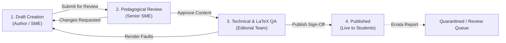
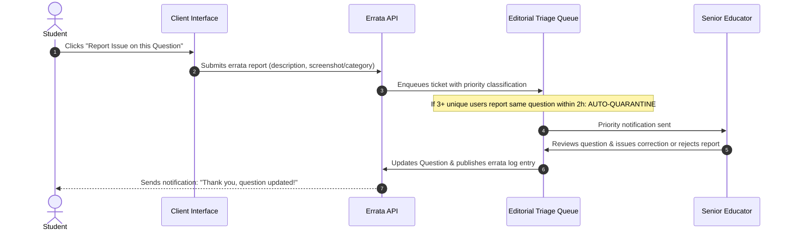

# Project Campus — Educational Content Quality & Verification Policy

**Document Version:** 1.0.0  
**Status:** Approved for Pedagogical Governance  
**Scope:** All Curricula, Question Banks, Lessons, Solutions, and AI Interactions  
**Last Updated:** October 2026  

---

## 1. Educational Accuracy Mandate

Academic excellence depends entirely on trust. A student preparing for a high-stakes examination such as CBSE Class 12 Boards, JEE Main, JEE Advanced, or NEET cannot afford to learn from erroneous explanations or flawed answer keys. A single incorrect formula or ambiguous question can waste dozens of hours of study time or cause profound conceptual confusion.

Project Campus operates under a **Zero-Tolerance Policy for Unverified Content** in its core curriculum and assessment engines:

1. **Every official question** must have an unambiguous, mathematically validated answer key and a step-by-step verified explanation authored or reviewed by a qualified educator.
2. **Every lesson** must align strictly with the target board syllabus or national examination guidelines (NCERT / NTA / CBSE frameworks).
3. **Every mathematical equation and chemical formula** must render correctly using standard scientific typography without syntax errors or unformatted text.

---

## 2. Multi-Stage Content Verification Lifecycle

All formal learning materials and questions must pass through a four-stage editorial review process before becoming visible to students.



### Stage 1: Draft Creation (Subject Matter Expert Author)
* Author writes the lesson text or question stem in Markdown with LaTeX equations.
* For questions: Author defines all options, specifies the exact correct key(s), sets numerical tolerance (if applicable), and writes the step-by-step solution.
* Questions are tagged with Bloom's Taxonomy cognitive level (Remember, Understand, Apply, Analyze, Evaluate) and target exam difficulty.

### Stage 2: Pedagogical & Accuracy Review (Senior SME / Reviewer)
* A second, independent educator solves the problem independently without looking at the author's answer key to confirm agreement.
* Evaluates clarity of wording, absence of cultural or linguistic bias, and strict syllabus alignment.
* Rejects or requests revisions if solutions use non-standard terminology or contain conceptual ambiguities.

### Stage 3: Technical & LaTeX QA (Editorial Team)
* Automated and manual checks for LaTeX rendering errors (e.g., mismatched brackets, missing escape sequences).
* Visual inspection of diagrams, graphs, and circuit schematics to ensure readability on high-DPI desktop screens and small mobile displays (360px).

### Stage 4: Publication & Version Stamping
* Content is marked as `PUBLISHED` and cryptographically or sequentially versioned in the database.
* The names/IDs of the author and reviewer are permanently bound to the audit record.

---

## 3. Strict Separation of Verified Content and AI-Generated Content

To eliminate confusion between authoritative textbook facts and probabilistic language model outputs, the system enforces a strict operational and visual boundary:

```
+--------------------------------------------------------------------------+
| VERIFIED EDUCATIONAL CONTENT (HUMAN-REVIEWED)                           |
| • Official Chapter Notes, Formula Sheets, and Diagrams                   |
| • Official Question Bank and Step-by-Step Verified Solutions            |
| • Authoritative Scoring and Answer Key Validation                       |
| -> UI Presentation: Clean academic typography, green verification badge   |
+--------------------------------------------------------------------------+
                                    ▲
                         STRICT ARCHITECTURAL WALL
                                    ▼
+--------------------------------------------------------------------------+
| AI-ASSISTED CONCEPT CLARIFIER (TRANSPARENT AI)                           |
| • Intuitive analogies and alternate concept breakdowns                   |
| • Mathematical step-by-step simplification                               |
| • Auxiliary 'Why does this happen?' doubt resolution                     |
| -> UI Presentation: Distinct purple/indigo card, explicit disclaimer:   |
|    "AI-Generated Pedagogical Aid — Cross-check with textbook solutions"  |
+--------------------------------------------------------------------------+
```

### Absolute Prohibitions on AI Content:
* **No Unreviewed AI in Question Banks:** AI models are never permitted to generate new live questions or answer keys directly into the production question bank without passing through human SME review (Stage 1 to 4).
* **No Authoritative Overrides:** An AI explanation can never contradict or override a verified human educator's solution. In any discrepancy, the verified solution is primary.

---

## 4. Student Errata Reporting & Quarantine SLA

Even with rigorous review, typographical or syllabus edge cases may emerge. Project Campus provides a transparent reporting and rapid remediation mechanism:



### Service-Level Agreements (SLAs) for Reported Errors:
* **Critical (Incorrect Answer Key / Invalid Solution):**
  * Auto-quarantined from active practice quizzes if reported by $\ge 3$ students or confirmed by reviewer.
  * Triage and correction within **24 hours**.
* **Major (Typographical error in formula or missing diagram):**
  * Triage and correction within **48 hours**.
* **Minor (Stylistic improvement, alternative shortcut suggestion):**
  * Triage during the next scheduled syllabus review cycle (within 14 days).

---

## 5. Grounded RAG & Anti-Hallucination Guidelines

When students invoke the AI Concept Clarifier, the system ensures truthful, syllabus-bounded responses through the following rules:

1. **Context Grounding (RAG):** Prompts sent to the AI model always inject verified NCERT/curriculum excerpts from the active chapter. The AI is instructed:
   > *"Answer the student's question based strictly on the provided textbook excerpts and standard physical/mathematical laws. If the concept is not covered in this curriculum, explicitly say so and suggest asking their teacher."*
2. **Explicit Confidence & Uncertainty:** If an AI model has low token probability or faces an ambiguous query, it must reply: *"I am not certain about this specific application. Please review Section X of your textbook or ask your teacher."*
3. **No Fabrication of Scientific Laws:** The AI is strictly barred from inventing fictitious formulas or non-existent chemical reactions.

---

## 6. Truthfulness, Credentialing & Marketing Ethics

Project Campus strictly prohibits deceptive marketing practices:

* **No Synthetic Testimonials:** Never display fake student reviews, manufactured quote cards, or fabricated stock photos pretending to be successful toppers.
* **No Fictitious Institutional Partnerships:** Never display logos of universities, school boards, or national examination authorities implying official endorsement unless a formal, legally executed partnership exists.
* **No Guaranteed Results:** Avoid claims such as "Guaranteed 99th percentile in JEE" or "100% NEET selection guarantee". Learning outcomes depend on individual student effort, deliberate practice, and mastery over time.
