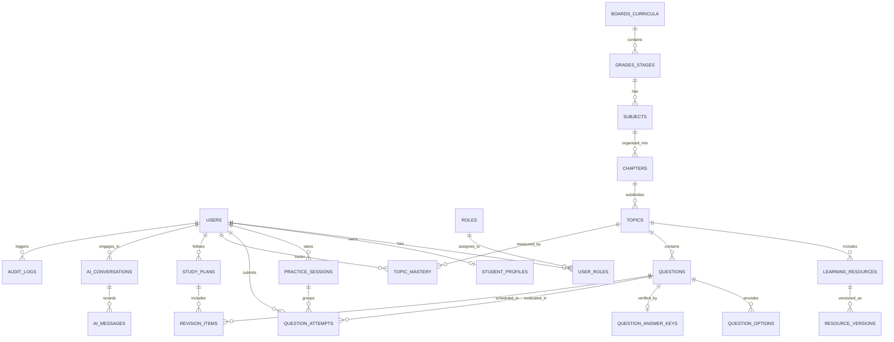

# Project Campus — Database Design Specification

**Document Version:** 1.0.0  
**Status:** Approved for Schema Implementation  
**Target RDBMS:** PostgreSQL 16+ (ACID Compliant)  
**ORM Framework:** SQLAlchemy 2.0 (Async) + Alembic  
**Last Updated:** October 2026  

---

## 1. Relational Entity-Relationship Diagram (ERD)



---

## 2. Table Specifications & Data Dictionary

### 2.1. Authentication, Authorization & User Management

#### `users`
Primary identity table storing account authentication credentials and status.
```sql
CREATE TABLE users (
    id UUID PRIMARY KEY DEFAULT gen_random_uuid(),
    email VARCHAR(255) UNIQUE NOT NULL,
    hashed_password VARCHAR(255) NOT NULL,
    full_name VARCHAR(150) NOT NULL,
    is_active BOOLEAN NOT NULL DEFAULT TRUE,
    is_verified BOOLEAN NOT NULL DEFAULT FALSE,
    created_at TIMESTAMPTZ NOT NULL DEFAULT CURRENT_TIMESTAMP,
    updated_at TIMESTAMPTZ NOT NULL DEFAULT CURRENT_TIMESTAMP
);
CREATE INDEX idx_users_email ON users(email);
```

#### `roles` and `user_roles`
Role-Based Access Control mapping users to one or more privileges (`STUDENT`, `EDUCATOR`, `REVIEWER`, `ADMIN`).
```sql
CREATE TABLE roles (
    id SERIAL PRIMARY KEY,
    name VARCHAR(50) UNIQUE NOT NULL, -- 'STUDENT', 'EDUCATOR', 'REVIEWER', 'ADMIN'
    description TEXT
);

CREATE TABLE user_roles (
    user_id UUID NOT NULL REFERENCES users(id) ON DELETE CASCADE,
    role_id INT NOT NULL REFERENCES roles(id) ON DELETE CASCADE,
    assigned_at TIMESTAMPTZ NOT NULL DEFAULT CURRENT_TIMESTAMP,
    PRIMARY KEY (user_id, role_id)
);
```

#### `student_profiles`
Academic details and preferences specific to student learners.
```sql
CREATE TABLE student_profiles (
    id UUID PRIMARY KEY DEFAULT gen_random_uuid(),
    user_id UUID UNIQUE NOT NULL REFERENCES users(id) ON DELETE CASCADE,
    target_curriculum_id UUID REFERENCES boards_curricula(id) ON DELETE SET NULL,
    grade_stage_id UUID REFERENCES grades_stages(id) ON DELETE SET NULL,
    target_exam_year INT,
    daily_study_goal_minutes INT DEFAULT 120,
    preferred_language VARCHAR(10) DEFAULT 'en',
    created_at TIMESTAMPTZ NOT NULL DEFAULT CURRENT_TIMESTAMP,
    updated_at TIMESTAMPTZ NOT NULL DEFAULT CURRENT_TIMESTAMP
);
CREATE INDEX idx_student_profiles_user ON student_profiles(user_id);
```

---

### 2.2. Curriculum & Content Taxonomy

#### `boards_curricula`
Top-level educational system or competitive exam board (e.g., `CBSE`, `JEE_MAIN`, `JEE_ADVANCED`, `NEET`, `ICSE`).
```sql
CREATE TABLE boards_curricula (
    id UUID PRIMARY KEY DEFAULT gen_random_uuid(),
    code VARCHAR(50) UNIQUE NOT NULL, -- 'CBSE', 'JEE_MAIN', 'NEET'
    name VARCHAR(150) NOT NULL,
    country_code VARCHAR(3) DEFAULT 'IND',
    description TEXT,
    is_active BOOLEAN DEFAULT TRUE,
    created_at TIMESTAMPTZ NOT NULL DEFAULT CURRENT_TIMESTAMP
);
```

#### `grades_stages`
Grade levels or academic stages (e.g., `Class 11`, `Class 12`, `Foundation 10`, `Dropper/Repeater`).
```sql
CREATE TABLE grades_stages (
    id UUID PRIMARY KEY DEFAULT gen_random_uuid(),
    board_id UUID NOT NULL REFERENCES boards_curricula(id) ON DELETE CASCADE,
    code VARCHAR(50) NOT NULL, -- 'CLASS_11', 'CLASS_12'
    name VARCHAR(100) NOT NULL,
    display_order INT NOT NULL DEFAULT 0,
    UNIQUE (board_id, code)
);
```

#### `subjects`
Academic disciplines (e.g., `Physics`, `Chemistry`, `Mathematics`, `Biology`).
```sql
CREATE TABLE subjects (
    id UUID PRIMARY KEY DEFAULT gen_random_uuid(),
    grade_stage_id UUID NOT NULL REFERENCES grades_stages(id) ON DELETE CASCADE,
    code VARCHAR(50) NOT NULL,
    name VARCHAR(100) NOT NULL,
    icon_url VARCHAR(255),
    display_order INT NOT NULL DEFAULT 0,
    UNIQUE (grade_stage_id, code)
);
```

#### `chapters`
Curriculum units within a subject (e.g., `Electrostatics`, `Thermodynamics`, `Rotational Motion`).
```sql
CREATE TABLE chapters (
    id UUID PRIMARY KEY DEFAULT gen_random_uuid(),
    subject_id UUID NOT NULL REFERENCES subjects(id) ON DELETE CASCADE,
    chapter_number INT NOT NULL,
    title VARCHAR(200) NOT NULL,
    slug VARCHAR(200) NOT NULL,
    summary TEXT,
    display_order INT NOT NULL DEFAULT 0,
    UNIQUE (subject_id, chapter_number)
);
```

#### `topics`
Granular concepts within a chapter (e.g., `Coulomb's Law`, `Electric Dipole Moment`, `Gauss's Law Applications`).
```sql
CREATE TABLE topics (
    id UUID PRIMARY KEY DEFAULT gen_random_uuid(),
    chapter_id UUID NOT NULL REFERENCES chapters(id) ON DELETE CASCADE,
    topic_number INT NOT NULL,
    title VARCHAR(200) NOT NULL,
    slug VARCHAR(200) NOT NULL,
    importance_weight INT DEFAULT 1, -- Pedagogical weight for readiness algorithms
    display_order INT NOT NULL DEFAULT 0,
    UNIQUE (chapter_id, topic_number)
);
CREATE INDEX idx_topics_chapter ON topics(chapter_id);
```

---

### 2.3. Structured Lessons & Learning Materials

#### `learning_resources`
Educational readings, formula sheets, and concept notes.
```sql
CREATE TYPE content_status AS ENUM ('DRAFT', 'UNDER_REVIEW', 'APPROVED', 'PUBLISHED', 'ARCHIVED');

CREATE TABLE learning_resources (
    id UUID PRIMARY KEY DEFAULT gen_random_uuid(),
    topic_id UUID NOT NULL REFERENCES topics(id) ON DELETE CASCADE,
    title VARCHAR(255) NOT NULL,
    content_markdown TEXT NOT NULL, -- Markdown containing LaTeX formulas ($...$ and $$...$$)
    estimated_read_time_minutes INT DEFAULT 10,
    status content_status NOT NULL DEFAULT 'DRAFT',
    created_by UUID REFERENCES users(id),
    reviewed_by UUID REFERENCES users(id),
    published_version INT DEFAULT 1,
    created_at TIMESTAMPTZ NOT NULL DEFAULT CURRENT_TIMESTAMP,
    updated_at TIMESTAMPTZ NOT NULL DEFAULT CURRENT_TIMESTAMP
);
CREATE INDEX idx_learning_resources_topic ON learning_resources(topic_id);
```

#### `resource_versions`
Audit history and revision tracking for all published lesson changes.
```sql
CREATE TABLE resource_versions (
    id UUID PRIMARY KEY DEFAULT gen_random_uuid(),
    resource_id UUID NOT NULL REFERENCES learning_resources(id) ON DELETE CASCADE,
    version_number INT NOT NULL,
    content_markdown TEXT NOT NULL,
    changed_by UUID REFERENCES users(id),
    change_summary TEXT,
    created_at TIMESTAMPTZ NOT NULL DEFAULT CURRENT_TIMESTAMP,
    UNIQUE (resource_id, version_number)
);
```

---

### 2.4. Question Bank, Evaluation & Explanations

#### `questions`
Core question repository with rich LaTeX support and pedagogical classification.
```sql
CREATE TYPE question_type AS ENUM (
    'SINGLE_CHOICE',       -- Standard 4-option MCQ (one correct)
    'MULTIPLE_CHOICE',     -- JEE Advanced multiple options correct
    'NUMERICAL',           -- Real number input with decimal tolerance
    'INTEGER',             -- Single or double digit integer response
    'ASSERTION_REASON'     -- Assertion and Reason pair evaluation
);

CREATE TYPE difficulty_level AS ENUM ('EASY', 'MEDIUM', 'HARD', 'EXPERT');

CREATE TABLE questions (
    id UUID PRIMARY KEY DEFAULT gen_random_uuid(),
    topic_id UUID NOT NULL REFERENCES topics(id) ON DELETE RESTRICT,
    q_type question_type NOT NULL,
    difficulty difficulty_level NOT NULL DEFAULT 'MEDIUM',
    content_latex TEXT NOT NULL, -- Question prompt with LaTeX
    diagram_url VARCHAR(500),    -- High-resolution verified diagram if applicable
    hints JSONB DEFAULT '[]',    -- Incremental hints array ["Hint 1", "Hint 2"]
    status content_status NOT NULL DEFAULT 'DRAFT',
    author_id UUID REFERENCES users(id),
    reviewer_id UUID REFERENCES users(id),
    created_at TIMESTAMPTZ NOT NULL DEFAULT CURRENT_TIMESTAMP,
    updated_at TIMESTAMPTZ NOT NULL DEFAULT CURRENT_TIMESTAMP
);
CREATE INDEX idx_questions_topic ON questions(topic_id);
CREATE INDEX idx_questions_status_difficulty ON questions(status, difficulty);
```

#### `question_options`
Options for multiple-choice questions.
```sql
CREATE TABLE question_options (
    id UUID PRIMARY KEY DEFAULT gen_random_uuid(),
    question_id UUID NOT NULL REFERENCES questions(id) ON DELETE CASCADE,
    option_key VARCHAR(10) NOT NULL, -- 'A', 'B', 'C', 'D'
    option_latex TEXT NOT NULL,
    display_order INT NOT NULL DEFAULT 0,
    UNIQUE (question_id, option_key)
);
CREATE INDEX idx_options_question ON question_options(question_id);
```

#### `question_answer_keys`
Authoritative, verified answers and step-by-step educator explanations.
```sql
CREATE TABLE question_answer_keys (
    id UUID PRIMARY KEY DEFAULT gen_random_uuid(),
    question_id UUID UNIQUE NOT NULL REFERENCES questions(id) ON DELETE CASCADE,
    correct_options JSONB,       -- e.g., ["B"] or ["A", "C"]
    numerical_value NUMERIC(12, 4), -- For numerical type questions
    numerical_tolerance NUMERIC(8, 4) DEFAULT 0.01, -- Allowed delta (+/-)
    integer_value INT,           -- For integer type questions
    step_by_step_explanation_latex TEXT NOT NULL, -- Step-by-step teacher derivation
    verified_by UUID NOT NULL REFERENCES users(id),
    verified_at TIMESTAMPTZ NOT NULL DEFAULT CURRENT_TIMESTAMP
);
```

---

### 2.5. Practice Sessions, Student Attempts & Mastery

#### `practice_sessions`
Represents an individual student practice session (topic drill, chapter test, or daily revision).
```sql
CREATE TABLE practice_sessions (
    id UUID PRIMARY KEY DEFAULT gen_random_uuid(),
    user_id UUID NOT NULL REFERENCES users(id) ON DELETE CASCADE,
    topic_id UUID REFERENCES topics(id) ON DELETE SET NULL,
    session_type VARCHAR(50) NOT NULL DEFAULT 'TOPIC_PRACTICE', -- 'TOPIC_PRACTICE', 'REVISION', 'MOCK'
    total_questions INT NOT NULL DEFAULT 0,
    correct_count INT NOT NULL DEFAULT 0,
    started_at TIMESTAMPTZ NOT NULL DEFAULT CURRENT_TIMESTAMP,
    completed_at TIMESTAMPTZ
);
CREATE INDEX idx_practice_sessions_user ON practice_sessions(user_id, started_at DESC);
```

#### `question_attempts`
Atomic record of every individual question answered by a student.
```sql
CREATE TABLE question_attempts (
    id UUID PRIMARY KEY DEFAULT gen_random_uuid(),
    session_id UUID REFERENCES practice_sessions(id) ON DELETE SET NULL,
    user_id UUID NOT NULL REFERENCES users(id) ON DELETE CASCADE,
    question_id UUID NOT NULL REFERENCES questions(id) ON DELETE RESTRICT,
    selected_options JSONB,      -- Array of chosen option keys e.g. ["A"]
    submitted_numerical NUMERIC(12, 4),
    submitted_integer INT,
    is_correct BOOLEAN NOT NULL,
    time_spent_seconds INT NOT NULL DEFAULT 0,
    attempted_at TIMESTAMPTZ NOT NULL DEFAULT CURRENT_TIMESTAMP
);
CREATE INDEX idx_attempts_user_question ON question_attempts(user_id, question_id);
CREATE INDEX idx_attempts_user_time ON question_attempts(user_id, attempted_at DESC);
```

#### `topic_mastery`
Aggregated mastery metrics for real-time learning gap diagnosis and spaced repetition.
```sql
CREATE TABLE topic_mastery (
    id UUID PRIMARY KEY DEFAULT gen_random_uuid(),
    user_id UUID NOT NULL REFERENCES users(id) ON DELETE CASCADE,
    topic_id UUID NOT NULL REFERENCES topics(id) ON DELETE CASCADE,
    attempts_count INT NOT NULL DEFAULT 0,
    correct_count INT NOT NULL DEFAULT 0,
    accuracy_percentage NUMERIC(5, 2) GENERATED ALWAYS AS (
        CASE WHEN attempts_count > 0 THEN (correct_count::numeric / attempts_count::numeric) * 100.0 ELSE 0.0 END
    ) STORED,
    mastery_score NUMERIC(5, 2) NOT NULL DEFAULT 0.0, -- Composite score (accuracy, recency, difficulty)
    last_practiced_at TIMESTAMPTZ,
    UNIQUE (user_id, topic_id)
);
CREATE INDEX idx_topic_mastery_lookup ON topic_mastery(user_id, topic_id);
```

---

### 2.6. Spaced Repetition & Study Planning

#### `study_plans`
Active study schedule and timeline for an individual student.
```sql
CREATE TABLE study_plans (
    id UUID PRIMARY KEY DEFAULT gen_random_uuid(),
    user_id UUID UNIQUE NOT NULL REFERENCES users(id) ON DELETE CASCADE,
    title VARCHAR(150) NOT NULL,
    target_date DATE NOT NULL,
    created_at TIMESTAMPTZ NOT NULL DEFAULT CURRENT_TIMESTAMP,
    updated_at TIMESTAMPTZ NOT NULL DEFAULT CURRENT_TIMESTAMP
);
```

#### `revision_items`
SuperMemo-2 (SM-2) spaced repetition schedule for questions and topics needing review.
```sql
CREATE TABLE revision_items (
    id UUID PRIMARY KEY DEFAULT gen_random_uuid(),
    study_plan_id UUID NOT NULL REFERENCES study_plans(id) ON DELETE CASCADE,
    user_id UUID NOT NULL REFERENCES users(id) ON DELETE CASCADE,
    question_id UUID NOT NULL REFERENCES questions(id) ON DELETE CASCADE,
    repetition_number INT NOT NULL DEFAULT 0,
    interval_days INT NOT NULL DEFAULT 1,
    ease_factor NUMERIC(4, 2) NOT NULL DEFAULT 2.50,
    next_due_date DATE NOT NULL,
    last_reviewed_at TIMESTAMPTZ,
    is_active BOOLEAN NOT NULL DEFAULT TRUE,
    UNIQUE (user_id, question_id)
);
CREATE INDEX idx_revision_due ON revision_items(user_id, next_due_date, is_active);
```

---

### 2.7. AI Concept Clarifier (Conversations & Logs)

#### `ai_conversations` and `ai_messages`
Stores student queries, grounded RAG contexts, and transparent AI responses.
```sql
CREATE TABLE ai_conversations (
    id UUID PRIMARY KEY DEFAULT gen_random_uuid(),
    user_id UUID NOT NULL REFERENCES users(id) ON DELETE CASCADE,
    topic_id UUID REFERENCES topics(id) ON DELETE SET NULL,
    question_id UUID REFERENCES questions(id) ON DELETE SET NULL,
    title VARCHAR(200) NOT NULL DEFAULT 'Concept Clarification',
    created_at TIMESTAMPTZ NOT NULL DEFAULT CURRENT_TIMESTAMP
);

CREATE TABLE ai_messages (
    id UUID PRIMARY KEY DEFAULT gen_random_uuid(),
    conversation_id UUID NOT NULL REFERENCES ai_conversations(id) ON DELETE CASCADE,
    sender_type VARCHAR(20) NOT NULL, -- 'STUDENT', 'AI_TUTOR'
    content TEXT NOT NULL,
    grounded_references JSONB,        -- Citations to specific chapter/topic sections
    student_rating VARCHAR(20),       -- 'HELPFUL', 'UNCLEAR', 'INACCURATE'
    created_at TIMESTAMPTZ NOT NULL DEFAULT CURRENT_TIMESTAMP
);
CREATE INDEX idx_ai_messages_convo ON ai_messages(conversation_id, created_at ASC);
```

---

### 2.8. Audit Trail & Errata Reporting

#### `audit_logs`
Immutable compliance and security log recording every administrative or content modification.
```sql
CREATE TABLE audit_logs (
    id UUID PRIMARY KEY DEFAULT gen_random_uuid(),
    actor_id UUID REFERENCES users(id) ON DELETE SET NULL,
    action VARCHAR(100) NOT NULL, -- 'PUBLISH_QUESTION', 'UPDATE_ANSWER_KEY', 'CHANGE_ROLE'
    resource_type VARCHAR(50) NOT NULL, -- 'QUESTION', 'LEARNING_RESOURCE', 'USER'
    resource_id UUID NOT NULL,
    diff_payload JSONB,
    ip_address VARCHAR(45),
    created_at TIMESTAMPTZ NOT NULL DEFAULT CURRENT_TIMESTAMP
);
CREATE INDEX idx_audit_logs_actor ON audit_logs(actor_id, created_at DESC);
CREATE INDEX idx_audit_logs_resource ON audit_logs(resource_type, resource_id);
```

#### `content_errata_reports`
User-submitted corrections for typographical, mathematical, or pedagogical inaccuracies.
```sql
CREATE TYPE report_status AS ENUM ('PENDING', 'INVESTIGATING', 'RESOLVED', 'REJECTED');

CREATE TABLE content_errata_reports (
    id UUID PRIMARY KEY DEFAULT gen_random_uuid(),
    reporter_id UUID NOT NULL REFERENCES users(id) ON DELETE CASCADE,
    question_id UUID REFERENCES questions(id) ON DELETE SET NULL,
    resource_id UUID REFERENCES learning_resources(id) ON DELETE SET NULL,
    description TEXT NOT NULL,
    status report_status NOT NULL DEFAULT 'PENDING',
    resolver_notes TEXT,
    resolved_by UUID REFERENCES users(id),
    created_at TIMESTAMPTZ NOT NULL DEFAULT CURRENT_TIMESTAMP,
    resolved_at TIMESTAMPTZ
);
CREATE INDEX idx_errata_status ON content_errata_reports(status, created_at ASC);
```

---

## 3. Row-Level Security & Authorization Rules

1. **Student Learner Isolation:**
   * Students can only `SELECT`, `INSERT`, and `UPDATE` their own records in `student_profiles`, `practice_sessions`, `question_attempts`, `topic_mastery`, `revision_items`, and `ai_conversations`.
   * Students can only `SELECT` records in `questions` and `learning_resources` where `status = 'PUBLISHED'`.
   * The authoritative `question_answer_keys` table is never exposed via raw API endpoints; only the evaluated result and step-by-step solution are returned post-submission.
2. **Author / Educator Scope:**
   * Authors can `INSERT` and `UPDATE` drafts in `questions` and `learning_resources` where `created_by = current_user`.
   * Authors cannot self-approve content to `'PUBLISHED'` status.
3. **Reviewer & Admin Scope:**
   * Reviewers have access to review queues and can update statuses from `'UNDER_REVIEW'` to `'APPROVED'` or `'PUBLISHED'`.
   * Admins have full oversight with all actions captured in `audit_logs`.
