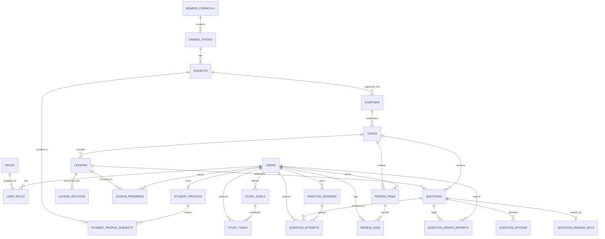

# Project Campus — Database Design Specification

**Document Version:** 1.0.0  
**Status:** Approved for Schema Implementation  
**Target RDBMS:** PostgreSQL 16+ (ACID Compliant)  
**ORM Framework:** SQLAlchemy 2.0 (Async) + Alembic  
**Last Updated:** October 2026  

---

## 1. Relational Entity-Relationship Diagram (ERD)



---

## 2. Table Specifications & Data Dictionary

### 2.1. Authentication, Authorization & User Management

#### `users`
Primary identity table storing account authentication credentials and status.
```sql
CREATE TABLE users (
    id UUID PRIMARY KEY DEFAULT gen_random_uuid(),
    email VARCHAR(255) UNIQUE NOT NULL,
    hashed_password VARCHAR(255) NOT NULL,
    full_name VARCHAR(150) NOT NULL,
    is_active BOOLEAN NOT NULL DEFAULT TRUE,
    is_verified BOOLEAN NOT NULL DEFAULT FALSE,
    created_at TIMESTAMPTZ NOT NULL DEFAULT CURRENT_TIMESTAMP,
    updated_at TIMESTAMPTZ NOT NULL DEFAULT CURRENT_TIMESTAMP
);
CREATE INDEX idx_users_email ON users(email);
```

#### `roles` and `user_roles`
Role-Based Access Control mapping users to one or more privileges (`STUDENT`, `EDUCATOR`, `REVIEWER`, `ADMIN`).
```sql
CREATE TABLE roles (
    id SERIAL PRIMARY KEY,
    name VARCHAR(50) UNIQUE NOT NULL, -- 'STUDENT', 'EDUCATOR', 'REVIEWER', 'ADMIN'
    description TEXT
);

CREATE TABLE user_roles (
    user_id UUID NOT NULL REFERENCES users(id) ON DELETE CASCADE,
    role_id INT NOT NULL REFERENCES roles(id) ON DELETE CASCADE,
    assigned_at TIMESTAMPTZ NOT NULL DEFAULT CURRENT_TIMESTAMP,
    PRIMARY KEY (user_id, role_id)
);
```

#### `student_profiles`
Academic details and preferences specific to student learners.
```sql
CREATE TABLE student_profiles (
    id UUID PRIMARY KEY DEFAULT gen_random_uuid(),
    user_id UUID UNIQUE NOT NULL REFERENCES users(id) ON DELETE CASCADE,
    target_curriculum_id UUID REFERENCES boards_curricula(id) ON DELETE SET NULL,
    grade_stage_id UUID REFERENCES grades_stages(id) ON DELETE SET NULL,
    target_exam_year INT,
    daily_study_goal_minutes INT NOT NULL DEFAULT 120,
    preferred_language VARCHAR(10) NOT NULL DEFAULT 'en',
    onboarding_completed BOOLEAN NOT NULL DEFAULT FALSE,
    created_at TIMESTAMPTZ NOT NULL DEFAULT CURRENT_TIMESTAMP,
    updated_at TIMESTAMPTZ NOT NULL DEFAULT CURRENT_TIMESTAMP
);
CREATE INDEX idx_student_profiles_user ON student_profiles(user_id);
```

#### `student_profile_subjects`
Enrolled subject selection join table for student profiles.
```sql
CREATE TABLE student_profile_subjects (
    profile_id UUID NOT NULL REFERENCES student_profiles(id) ON DELETE CASCADE,
    subject_id UUID NOT NULL REFERENCES subjects(id) ON DELETE CASCADE,
    assigned_at TIMESTAMPTZ NOT NULL DEFAULT CURRENT_TIMESTAMP,
    PRIMARY KEY (profile_id, subject_id)
);
```

---

### 2.2. Curriculum & Content Taxonomy

#### `boards_curricula`
Top-level educational system or competitive exam board (e.g., `CBSE`, `JEE_MAIN`, `JEE_ADVANCED`, `NEET`, `ICSE`).
```sql
CREATE TABLE boards_curricula (
    id UUID PRIMARY KEY DEFAULT gen_random_uuid(),
    code VARCHAR(50) UNIQUE NOT NULL, -- 'CBSE', 'JEE_MAIN', 'NEET'
    name VARCHAR(150) NOT NULL,
    country_code VARCHAR(3) DEFAULT 'IND',
    description TEXT,
    is_active BOOLEAN DEFAULT TRUE,
    created_at TIMESTAMPTZ NOT NULL DEFAULT CURRENT_TIMESTAMP
);
```

#### `grades_stages`
Grade levels or academic stages (e.g., `Class 11`, `Class 12`, `Foundation 10`, `Dropper/Repeater`).
```sql
CREATE TABLE grades_stages (
    id UUID PRIMARY KEY DEFAULT gen_random_uuid(),
    board_id UUID NOT NULL REFERENCES boards_curricula(id) ON DELETE CASCADE,
    code VARCHAR(50) NOT NULL, -- 'CLASS_11', 'CLASS_12'
    name VARCHAR(100) NOT NULL,
    display_order INT NOT NULL DEFAULT 0,
    UNIQUE (board_id, code)
);
```

#### `subjects`
Academic disciplines (e.g., `Physics`, `Chemistry`, `Mathematics`, `Biology`).
```sql
CREATE TABLE subjects (
    id UUID PRIMARY KEY DEFAULT gen_random_uuid(),
    grade_stage_id UUID NOT NULL REFERENCES grades_stages(id) ON DELETE CASCADE,
    code VARCHAR(50) NOT NULL,
    name VARCHAR(100) NOT NULL,
    icon_url VARCHAR(255),
    display_order INT NOT NULL DEFAULT 0,
    UNIQUE (grade_stage_id, code)
);
```

#### `chapters`
Curriculum units within a subject (e.g., `Electrostatics`, `Thermodynamics`, `Rotational Motion`).
```sql
CREATE TABLE chapters (
    id UUID PRIMARY KEY DEFAULT gen_random_uuid(),
    subject_id UUID NOT NULL REFERENCES subjects(id) ON DELETE CASCADE,
    chapter_number INT NOT NULL,
    title VARCHAR(200) NOT NULL,
    slug VARCHAR(200) NOT NULL,
    summary TEXT,
    display_order INT NOT NULL DEFAULT 0,
    UNIQUE (subject_id, chapter_number)
);
```

#### `topics`
Granular concepts within a chapter (e.g., `Coulomb's Law`, `Electric Dipole Moment`, `Gauss's Law Applications`).
```sql
CREATE TABLE topics (
    id UUID PRIMARY KEY DEFAULT gen_random_uuid(),
    chapter_id UUID NOT NULL REFERENCES chapters(id) ON DELETE CASCADE,
    topic_number INT NOT NULL,
    title VARCHAR(200) NOT NULL,
    slug VARCHAR(200) NOT NULL,
    importance_weight INT DEFAULT 1, -- Pedagogical weight for readiness algorithms
    display_order INT NOT NULL DEFAULT 0,
    UNIQUE (chapter_id, topic_number)
);
CREATE INDEX idx_topics_chapter ON topics(chapter_id);
```

---

### 2.3. Structured Lessons & Reading Progress

#### `lessons`
Structured educational reading and concept guides attached to curriculum topics.
```sql
CREATE TABLE lessons (
    id UUID PRIMARY KEY DEFAULT gen_random_uuid(),
    topic_id UUID NOT NULL REFERENCES topics(id) ON DELETE CASCADE,
    title VARCHAR(255) NOT NULL,
    slug VARCHAR(255) NOT NULL,
    summary TEXT,
    learning_objectives JSONB DEFAULT '[]',
    estimated_read_time_minutes INT NOT NULL DEFAULT 10,
    status VARCHAR(20) NOT NULL DEFAULT 'DRAFT', -- 'DRAFT', 'IN_REVIEW', 'PUBLISHED', 'ARCHIVED'
    display_order INT NOT NULL DEFAULT 0,
    provenance VARCHAR(255),
    is_verified BOOLEAN NOT NULL DEFAULT FALSE,
    reviewed_by UUID REFERENCES users(id) ON DELETE SET NULL,
    created_at TIMESTAMPTZ NOT NULL DEFAULT CURRENT_TIMESTAMP,
    updated_at TIMESTAMPTZ NOT NULL DEFAULT CURRENT_TIMESTAMP,
    CONSTRAINT uq_lesson_topic_slug UNIQUE (topic_id, slug)
);
CREATE INDEX idx_lessons_topic ON lessons(topic_id);
CREATE INDEX idx_lessons_status ON lessons(status);
```

#### `lesson_sections`
Ordered pedagogical blocks within a structured lesson (concepts, worked examples, formulas, notes).
```sql
CREATE TABLE lesson_sections (
    id UUID PRIMARY KEY DEFAULT gen_random_uuid(),
    lesson_id UUID NOT NULL REFERENCES lessons(id) ON DELETE CASCADE,
    section_number INT NOT NULL,
    title VARCHAR(255) NOT NULL,
    content_markdown TEXT NOT NULL,
    section_type VARCHAR(50) NOT NULL DEFAULT 'CONCEPT', -- 'CONCEPT', 'WORKED_EXAMPLE', 'KEY_FORMULA', 'NOTE'
    display_order INT NOT NULL DEFAULT 0,
    created_at TIMESTAMPTZ NOT NULL DEFAULT CURRENT_TIMESTAMP,
    updated_at TIMESTAMPTZ NOT NULL DEFAULT CURRENT_TIMESTAMP,
    CONSTRAINT uq_lesson_section_num UNIQUE (lesson_id, section_number)
);
CREATE INDEX idx_lesson_sections_lesson ON lesson_sections(lesson_id);
```

#### `lesson_progress`
Persistent tracking of student reading engagement and completion status.
```sql
CREATE TABLE lesson_progress (
    id UUID PRIMARY KEY DEFAULT gen_random_uuid(),
    user_id UUID NOT NULL REFERENCES users(id) ON DELETE CASCADE,
    lesson_id UUID NOT NULL REFERENCES lessons(id) ON DELETE CASCADE,
    status VARCHAR(20) NOT NULL DEFAULT 'IN_PROGRESS', -- 'IN_PROGRESS', 'COMPLETED'
    started_at TIMESTAMPTZ NOT NULL DEFAULT CURRENT_TIMESTAMP,
    completed_at TIMESTAMPTZ,
    last_accessed_at TIMESTAMPTZ NOT NULL DEFAULT CURRENT_TIMESTAMP,
    created_at TIMESTAMPTZ NOT NULL DEFAULT CURRENT_TIMESTAMP,
    updated_at TIMESTAMPTZ NOT NULL DEFAULT CURRENT_TIMESTAMP,
    CONSTRAINT uq_user_lesson_progress UNIQUE (user_id, lesson_id)
);
CREATE INDEX idx_lesson_progress_user_status ON lesson_progress(user_id, status);
CREATE INDEX idx_lesson_progress_user_accessed ON lesson_progress(user_id, last_accessed_at);
```

---

### 2.4. Question Bank & Answer Key Verification

#### `questions`
Core question repository supporting LaTeX notation, hints, and diagram attachments.
```sql
CREATE TABLE questions (
    id UUID PRIMARY KEY DEFAULT gen_random_uuid(),
    topic_id UUID NOT NULL REFERENCES topics(id) ON DELETE CASCADE,
    lesson_id UUID REFERENCES lessons(id) ON DELETE SET NULL,
    question_type VARCHAR(30) NOT NULL DEFAULT 'SINGLE_CHOICE', -- 'SINGLE_CHOICE', 'MULTIPLE_CHOICE', 'NUMERICAL', 'INTEGER'
    difficulty VARCHAR(20) NOT NULL DEFAULT 'MEDIUM', -- 'EASY', 'MEDIUM', 'HARD', 'EXPERT'
    content_latex TEXT NOT NULL,
    hints JSONB DEFAULT '[]',
    diagram_url VARCHAR(500),
    status VARCHAR(20) NOT NULL DEFAULT 'DRAFT', -- 'DRAFT', 'IN_REVIEW', 'PUBLISHED', 'ARCHIVED'
    provenance VARCHAR(255),
    is_verified BOOLEAN NOT NULL DEFAULT FALSE,
    author_id UUID REFERENCES users(id) ON DELETE SET NULL,
    reviewer_id UUID REFERENCES users(id) ON DELETE SET NULL,
    created_at TIMESTAMPTZ NOT NULL DEFAULT CURRENT_TIMESTAMP,
    updated_at TIMESTAMPTZ NOT NULL DEFAULT CURRENT_TIMESTAMP
);
CREATE INDEX idx_questions_topic ON questions(topic_id);
CREATE INDEX idx_questions_lesson ON questions(lesson_id);
CREATE INDEX idx_questions_status_difficulty ON questions(status, difficulty);
```

#### `question_options`
Answer options for multiple choice questions.
```sql
CREATE TABLE question_options (
    id UUID PRIMARY KEY DEFAULT gen_random_uuid(),
    question_id UUID NOT NULL REFERENCES questions(id) ON DELETE CASCADE,
    option_key VARCHAR(10) NOT NULL, -- 'A', 'B', 'C', 'D'
    content_latex TEXT NOT NULL,
    display_order INT NOT NULL DEFAULT 0,
    created_at TIMESTAMPTZ NOT NULL DEFAULT CURRENT_TIMESTAMP,
    updated_at TIMESTAMPTZ NOT NULL DEFAULT CURRENT_TIMESTAMP,
    CONSTRAINT uq_question_option_key UNIQUE (question_id, option_key)
);
CREATE INDEX idx_question_options_qid ON question_options(question_id);
```

#### `question_answer_keys`
Verified educator derivations and correct answer specifications.
```sql
CREATE TABLE question_answer_keys (
    id UUID PRIMARY KEY DEFAULT gen_random_uuid(),
    question_id UUID UNIQUE NOT NULL REFERENCES questions(id) ON DELETE CASCADE,
    correct_options JSONB,       -- e.g., ["B"] or ["A", "C"]
    numerical_value FLOAT,
    numerical_tolerance FLOAT DEFAULT 0.01,
    integer_value INT,
    explanation_latex TEXT NOT NULL,
    verified_by UUID REFERENCES users(id) ON DELETE SET NULL,
    created_at TIMESTAMPTZ NOT NULL DEFAULT CURRENT_TIMESTAMP,
    updated_at TIMESTAMPTZ NOT NULL DEFAULT CURRENT_TIMESTAMP
);
```

---

### 2.5. Practice Sessions, Student Attempts & Errata Feedback

#### `practice_sessions`
Interactive topic practice session container.
```sql
CREATE TABLE practice_sessions (
    id UUID PRIMARY KEY DEFAULT gen_random_uuid(),
    user_id UUID NOT NULL REFERENCES users(id) ON DELETE CASCADE,
    topic_id UUID REFERENCES topics(id) ON DELETE SET NULL,
    session_type VARCHAR(50) NOT NULL DEFAULT 'TOPIC_PRACTICE',
    total_questions INT NOT NULL DEFAULT 0,
    correct_count INT NOT NULL DEFAULT 0,
    is_completed BOOLEAN NOT NULL DEFAULT FALSE,
    completed_at TIMESTAMPTZ,
    created_at TIMESTAMPTZ NOT NULL DEFAULT CURRENT_TIMESTAMP,
    updated_at TIMESTAMPTZ NOT NULL DEFAULT CURRENT_TIMESTAMP
);
CREATE INDEX idx_practice_sessions_user ON practice_sessions(user_id, created_at DESC);
```

#### `question_attempts`
Atomic record of individual question responses submitted by students.
```sql
CREATE TABLE question_attempts (
    id UUID PRIMARY KEY DEFAULT gen_random_uuid(),
    session_id UUID REFERENCES practice_sessions(id) ON DELETE CASCADE,
    user_id UUID NOT NULL REFERENCES users(id) ON DELETE CASCADE,
    question_id UUID NOT NULL REFERENCES questions(id) ON DELETE CASCADE,
    selected_options JSONB,
    submitted_numerical FLOAT,
    submitted_integer INT,
    is_correct BOOLEAN NOT NULL,
    time_spent_seconds INT NOT NULL DEFAULT 0,
    attempted_at TIMESTAMPTZ NOT NULL DEFAULT CURRENT_TIMESTAMP
);
CREATE INDEX idx_attempts_user_question ON question_attempts(user_id, question_id);
CREATE INDEX idx_attempts_user_time ON question_attempts(user_id, attempted_at DESC);
```

#### `question_errata_reports`
User feedback mechanism for reporting typographical or pedagogical errors in questions.
```sql
CREATE TABLE question_errata_reports (
    id UUID PRIMARY KEY DEFAULT gen_random_uuid(),
    question_id UUID NOT NULL REFERENCES questions(id) ON DELETE CASCADE,
    user_id UUID NOT NULL REFERENCES users(id) ON DELETE CASCADE,
    issue_type VARCHAR(50) NOT NULL DEFAULT 'TYPO', -- 'INCORRECT_ANSWER', 'TYPO', 'AMBIGUOUS_QUESTION', 'MISSING_DIAGRAM', 'OTHER'
    description TEXT NOT NULL,
    status VARCHAR(20) NOT NULL DEFAULT 'OPEN', -- 'OPEN', 'RESOLVED', 'REJECTED'
    created_at TIMESTAMPTZ NOT NULL DEFAULT CURRENT_TIMESTAMP,
    updated_at TIMESTAMPTZ NOT NULL DEFAULT CURRENT_TIMESTAMP
);
CREATE INDEX idx_errata_question ON question_errata_reports(question_id);
CREATE INDEX idx_errata_user ON question_errata_reports(user_id);
```

---

### 2.6. Study Planning & Daily Tasks

#### `study_goals`
Academic targets, exam horizons, and weekly study day preferences for students.
```sql
CREATE TABLE study_goals (
    id UUID PRIMARY KEY DEFAULT gen_random_uuid(),
    user_id UUID NOT NULL REFERENCES users(id) ON DELETE CASCADE,
    title VARCHAR(150) NOT NULL DEFAULT 'Academic Preparation',
    target_date DATE,
    daily_study_minutes INT NOT NULL DEFAULT 120,
    preferred_days JSONB NOT NULL DEFAULT '["MON", "TUE", "WED", "THU", "FRI", "SAT", "SUN"]',
    status VARCHAR(20) NOT NULL DEFAULT 'ACTIVE', -- 'ACTIVE', 'PAUSED', 'COMPLETED', 'ARCHIVED'
    created_at TIMESTAMPTZ NOT NULL DEFAULT CURRENT_TIMESTAMP,
    updated_at TIMESTAMPTZ NOT NULL DEFAULT CURRENT_TIMESTAMP
);
CREATE INDEX idx_study_goals_user_status ON study_goals(user_id, status);
```

#### `study_tasks`
Granular daily scheduled study activities (reading lessons, practice drills, topic review).
```sql
CREATE TABLE study_tasks (
    id UUID PRIMARY KEY DEFAULT gen_random_uuid(),
    user_id UUID NOT NULL REFERENCES users(id) ON DELETE CASCADE,
    goal_id UUID REFERENCES study_goals(id) ON DELETE SET NULL,
    scheduled_date DATE NOT NULL,
    task_type VARCHAR(30) NOT NULL DEFAULT 'STUDY_LESSON', -- 'STUDY_LESSON', 'RESUME_LESSON', 'PRACTICE_TOPIC', 'REVISE_TOPIC'
    title VARCHAR(255) NOT NULL,
    subject_id UUID REFERENCES subjects(id) ON DELETE SET NULL,
    subject_name VARCHAR(100),
    chapter_id UUID REFERENCES chapters(id) ON DELETE SET NULL,
    topic_id UUID REFERENCES topics(id) ON DELETE SET NULL,
    lesson_id UUID REFERENCES lessons(id) ON DELETE SET NULL,
    estimated_minutes INT NOT NULL DEFAULT 15,
    status VARCHAR(20) NOT NULL DEFAULT 'PENDING', -- 'PENDING', 'COMPLETED', 'SKIPPED', 'RESCHEDULED'
    is_completed BOOLEAN NOT NULL DEFAULT FALSE,
    completed_at TIMESTAMPTZ,
    display_order INT NOT NULL DEFAULT 0,
    reason VARCHAR(255),
    created_at TIMESTAMPTZ NOT NULL DEFAULT CURRENT_TIMESTAMP,
    updated_at TIMESTAMPTZ NOT NULL DEFAULT CURRENT_TIMESTAMP,
    CONSTRAINT uq_study_tasks_user_date_order UNIQUE (user_id, scheduled_date, display_order)
);
CREATE INDEX idx_study_tasks_user_date ON study_tasks(user_id, scheduled_date);
CREATE INDEX idx_study_tasks_user_status ON study_tasks(user_id, is_completed);
CREATE INDEX idx_study_tasks_lookup ON study_tasks(user_id, scheduled_date, is_completed);
```

---

### 2.7. Spaced Repetition (SuperMemo-2) & Review Logs

#### `review_items`
Active retention and spaced repetition tracking state for academic topics.
```sql
CREATE TABLE review_items (
    id UUID PRIMARY KEY DEFAULT gen_random_uuid(),
    user_id UUID NOT NULL REFERENCES users(id) ON DELETE CASCADE,
    topic_id UUID NOT NULL REFERENCES topics(id) ON DELETE CASCADE,
    subject_id UUID NOT NULL REFERENCES subjects(id) ON DELETE CASCADE,
    repetition_count INT NOT NULL DEFAULT 0,
    ease_factor FLOAT NOT NULL DEFAULT 2.50,
    interval_days INT NOT NULL DEFAULT 0,
    due_date DATE NOT NULL,
    status VARCHAR(20) NOT NULL DEFAULT 'LEARNING', -- 'LEARNING', 'REVIEW', 'MASTERED'
    last_reviewed_at TIMESTAMPTZ,
    created_at TIMESTAMPTZ NOT NULL DEFAULT CURRENT_TIMESTAMP,
    updated_at TIMESTAMPTZ NOT NULL DEFAULT CURRENT_TIMESTAMP,
    CONSTRAINT uq_review_items_user_topic UNIQUE (user_id, topic_id)
);
CREATE INDEX idx_review_items_user_due ON review_items(user_id, due_date, status);
CREATE INDEX idx_review_items_user_subject ON review_items(user_id, subject_id);
```

#### `review_logs`
Immutable history of student recall attempts and SM-2 parameter shifts.
```sql
CREATE TABLE review_logs (
    id UUID PRIMARY KEY DEFAULT gen_random_uuid(),
    review_item_id UUID NOT NULL REFERENCES review_items(id) ON DELETE CASCADE,
    user_id UUID NOT NULL REFERENCES users(id) ON DELETE CASCADE,
    quality_score INT NOT NULL, -- 0-5 Recall Quality
    time_spent_seconds INT NOT NULL DEFAULT 0,
    scheduled_interval_days INT NOT NULL,
    next_interval_days INT NOT NULL,
    ease_factor_before FLOAT NOT NULL,
    ease_factor_after FLOAT NOT NULL,
    reviewed_at TIMESTAMPTZ NOT NULL DEFAULT CURRENT_TIMESTAMP
);
CREATE INDEX idx_review_logs_user_reviewed ON review_logs(user_id, reviewed_at);
```

---

### 2.8. Planned Schema Extensions (Post-Pilot Roadmap)

The following entities represent forward-looking specifications scheduled for subsequent platform releases:
* **`ai_conversations` and `ai_messages`:** Threaded AI concept clarification sessions with citation metadata and grounded syllabus references.
* **`audit_logs`:** Dedicated immutable system audit trail logging administrative role updates, question publication approvals, and account closures.

---

## 3. Row-Level Security & Authorization Rules

1. **Student Learner Isolation:**
   * Students can only `SELECT`, `INSERT`, and `UPDATE` their own records in `student_profiles`, `student_profile_subjects`, `lesson_progress`, `practice_sessions`, `question_attempts`, `question_errata_reports`, `study_goals`, `study_tasks`, `review_items`, and `review_logs`.
   * Students can only `SELECT` records in `questions` and `lessons` where `status = 'PUBLISHED'`.
   * The authoritative `question_answer_keys` table is never exposed via raw API endpoints; only the evaluated result and step-by-step solution are returned post-submission.
2. **Author / Educator Scope:**
   * Authors can `INSERT` and `UPDATE` drafts in `questions` and `lessons` where `author_id = current_user`.
   * Authors cannot self-approve content to `'PUBLISHED'` status.
3. **Reviewer & Admin Scope:**
   * Reviewers have access to review queues and can update statuses from `'IN_REVIEW'` to `'PUBLISHED'`.
   * Admins have full administrative oversight across user roles and curricula taxonomy.
