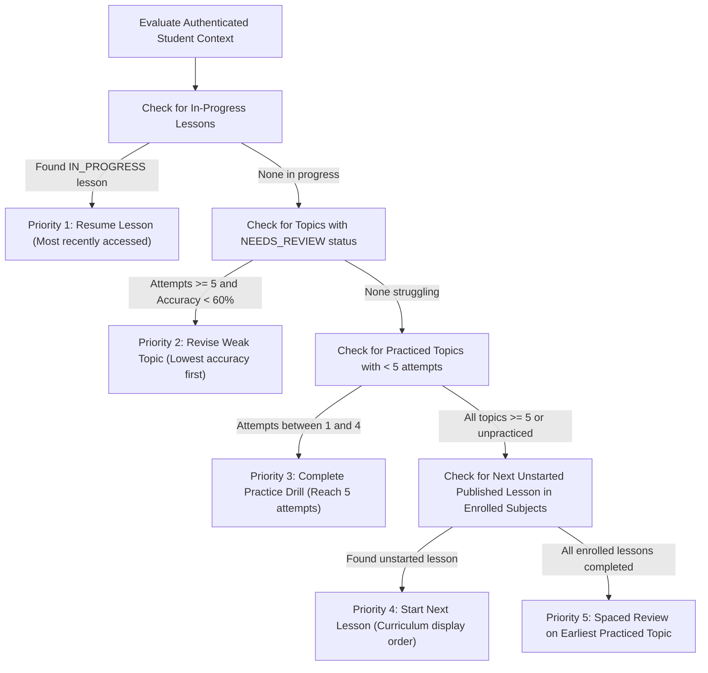
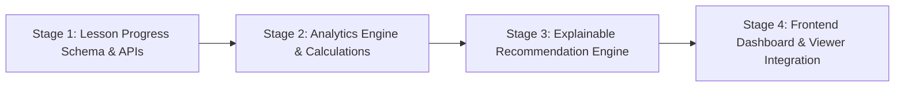

# Project Campus — Milestone 5 Implementation Plan
## Student Progress Tracking & Learning Analytics

**Document Version:** 1.0.0  
**Status:** PROPOSED & READY FOR STAKEHOLDER REVIEW  
**Auditor / Architect Role:** Lead Software Architect & Assessment Systems Engineer  
**Baseline Git Commit:** `a1530e6` (`audit: complete milestone 4 security, correctness, and quality audit`)  
**Target Milestone:** Milestone 5 — Student Progress Tracking & Learning Analytics  

---

## 1. Executive Summary

Milestone 5 builds the foundational progress tracking and learning analytics engine for Project Campus. While Milestones 1 through 4 established authentication, student onboarding, the curriculum taxonomy, structured lessons, and the topic-based question practice engine, students currently lack visibility into their overall study progress, lesson completion states, cumulative practice metrics, and actionable revision guidance.

The core objective of Milestone 5 is to deliver an **authoritative, real-time, persisted progress tracking and diagnostic analytics foundation** that helps students answer:
1. *What have I studied, and which lessons have I finished?*
2. *How much practice have I completed, and what is my actual observed accuracy?*
3. *Which specific topics have demonstrated conceptual gaps that require revision?*
4. *What is the most constructive next learning step to take right now?*

In strict adherence to the project's educational and architectural principles:
* **No fabricated data:** All metrics, scores, completion states, and activity feeds reflect genuine, persisted student interactions.
* **No diagnostic overreach:** Topics are never classified as "Mastered" from a small handful of questions, nor labeled "Struggling" without statistically adequate attempt evidence ($\ge 5$ attempts).
* **No external AI dependencies:** Recommendations and topic gap classifications are 100% deterministic, explainable, and rule-based.
* **No redundant statistical cache tables:** Following the core architecture directive, analytics are dynamically calculated from authoritative atomic records (`question_attempts`, `practice_sessions`, and the new `lesson_progress` table) to eliminate cache invalidation bugs and data drift.

---

## 2. Actual Repository State & Current Commit

### 2.1. Version Control & Workspace
* **Current Git Commit:** `a1530e6`
* **Current Branch:** `master`
* **Working Tree:** Clean (zero uncommitted or untracked changes)
* **Preceding Milestone 4 Commit:** `e662554`

### 2.2. Runtime Environment & Toolchain
* **Backend:** Python 3.14.3, FastAPI 0.133.1, SQLAlchemy 2.0.48, Pydantic 2.12.5, Alembic 1.18.3, Pytest 9.1.1
* **Frontend:** Node.js v25.8.0, npm 11.16.0, React 18.3.1, TypeScript 5.5.3, Vite 5.4.21, Tailwind CSS 3.4.11, Vitest 4.1.11, Lucide React
* **Database Dialects:** SQLite via `aiosqlite` for zero-configuration local development (`project_campus_dev.db`), PostgreSQL 16+ with `asyncpg` as production target
* **Current Alembic Head:** `0cb437c7683c` (`0cb437c7683c_milestone_4_question_bank_and_assessment.py`)

### 2.3. Test Suite Baseline
* **Backend Tests:** 70/70 passing (`pytest -v`), 0 warnings, across authentication, authorization, curriculum content, onboarding, practice engine, and security audits.
* **Frontend Tests:** 24/24 passing (`vitest run`), 7/7 test suites passing.
* **Production Build:** `npm run build` succeeds cleanly (`tsc && vite build`), generating optimized bundles.

---

## 3. Verified Existing Capabilities

The existing implementation provides the following verified capabilities that will be leveraged for Milestone 5:

1. **Authenticated Student Identity:**
   * JWT bearer tokens and optional HttpOnly cookies validated via `get_current_user` and `get_current_student` in [`backend/app/api/deps.py`](file:///c:/Users/LOQ/OneDrive/Desktop/project_campus/backend/app/api/deps.py).
   * Strict student role enforcement via `require_role("STUDENT")`.
   * Enrolled subjects and target examination stage stored in `StudentProfile` and `StudentProfileSubject`.

2. **Published Curriculum Hierarchy:**
   * Boards $\rightarrow$ Grade Stages $\rightarrow$ Subjects $\rightarrow$ Chapters $\rightarrow$ Topics $\rightarrow$ Lessons $\rightarrow$ Lesson Sections.
   * Editorial status filtering: Only `PUBLISHED` lessons and questions are visible to students.

3. **Assessment & Question Attempt Tracking:**
   * `PracticeSession` records session metadata (`user_id`, `topic_id`, `total_questions`, `correct_count`, `is_completed`, `completed_at`, `created_at`).
   * `QuestionAttempt` stores atomic student answers (`session_id`, `user_id`, `question_id`, `is_correct`, `time_spent_seconds`, `attempted_at`).
   * IDOR protection verified: Students cannot inject attempts into another student's session.
   * Duplicate submission rejection in practice sessions verified.
   * Floating-point tolerance comparison with epsilon boundary buffers verified.

4. **Existing Student Dashboard UI:**
   * [`frontend/src/components/dashboard/StudentDashboard.tsx`](file:///c:/Users/LOQ/OneDrive/Desktop/project_campus/frontend/src/components/dashboard/StudentDashboard.tsx) renders student greeting, curriculum stage, enrolled subjects, daily study target adjuster, and a basic recent practice session list.

---

## 4. Existing Limitations & Known Technical Debt

1. **Absence of Lesson Progress Tracking:**
   * The database contains no table or columns tracking which lessons a student has opened, started, or finished.
   * When a student returns to the curriculum browser or a lesson viewer, there is no visual indicator showing whether a lesson is "Not Started", "In Progress", or "Completed".
   * A student cannot resume an unfinished lesson from their dashboard.

2. **Unaggregated Topic Practice Analytics:**
   * Practice sessions and attempts exist in the database, but there is no endpoint aggregating performance by topic.
   * The dashboard only displays the raw `GET /api/v1/practice/history` list (last 5 sessions) without topic-level accuracy, question totals, or mastery classification.

3. **Absence of Pedagogical Recommendations:**
   * The dashboard has no system suggesting what the student should study next based on their completed lessons, weak practice areas, or enrolled subjects.

4. **Incomplete Session Display in Frontend:**
   * The current dashboard does not visually differentiate incomplete practice sessions from completed ones, and does not show subject names for sessions.

---

## 5. Functional Requirements for Milestone 5

### Requirement 1: Lesson Progress Tracking
* **Start / Access Tracking:** When an authenticated student opens a published lesson in the viewer, the system records or updates their progress as `"IN_PROGRESS"`, setting `started_at` (if new) and updating `last_accessed_at`.
* **Explicit Completion Action:** Opening a lesson does **not** mark it as completed. The student must trigger an explicit, dedicated "Mark Lesson as Completed" action inside the lesson viewer.
* **Idempotency:** Repeated completion requests do not create duplicate records; they safely update `completed_at` and `last_accessed_at`.
* **State Visibility:** Students can see their lesson state (`NOT_STARTED`, `IN_PROGRESS`, `COMPLETED`) across both the Lesson Viewer, Curriculum Browser, and Student Dashboard.
* **Resumption:** The student can click on an in-progress lesson from their dashboard to resume reading immediately.
* **Publication State Integrity:** If a lesson is subsequently unpublished (`DRAFT` or `ARCHIVED`), historical progress records remain in the database for audit integrity, but public endpoints and dashboard views exclude unpublished lessons.

### Requirement 2: Comprehensive Practice History & Analytics
* Students can view their complete practice session history, including:
  * Session completion state (`COMPLETED` vs `IN_PROGRESS`).
  * Questions answered vs total questions in session.
  * Correct answers and session observed accuracy percentage.
  * Associated Topic title and Subject name (e.g., "Physics • Electrostatics").
  * Session start and completion timestamps.

### Requirement 3: Topic-Level Performance Breakdown
* Aggregated metrics per topic derived from atomic `question_attempts` and `practice_sessions`:
  * Total submitted attempts.
  * Correct attempts and incorrect attempts.
  * Observed accuracy percentage (or `null` if 0 attempts).
  * Completed practice sessions count.
  * Most recent practice timestamp (`last_practiced_at`).
  * Pedagogical status classification:
    * `STRONG`: $\ge 5$ attempts, $\ge 80\%$ accuracy.
    * `DEVELOPING`: $\ge 5$ attempts, $60\% \le \text{accuracy} < 80\%$.
    * `NEEDS_REVIEW`: $\ge 5$ attempts, $< 60\%$ accuracy.
    * `INSUFFICIENT_DATA`: $< 5$ attempts.

### Requirement 4: Explainable Rule-Based Next-Step Recommendations
* High-value learning suggestions generated without external AI models:
  1. **Resume In-Progress Lesson:** Suggests continuing the most recently accessed uncompleted lesson.
  2. **Revise Struggling Topic:** Identifies enrolled topics categorized as `NEEDS_REVIEW` ($\ge 5$ attempts, $< 60\%$ accuracy), prioritized by lowest accuracy.
  3. **Build Statistical Confidence:** Identifies topics with $1$ to $4$ attempts, encouraging the student to complete a full 5-question drill.
  4. **Start Next Lesson:** Identifies the first unstarted published lesson in the student's enrolled subjects in curriculum display order.

### Requirement 5: Enhanced Student Dashboard
* Elevate [`StudentDashboard.tsx`](file:///c:/Users/LOQ/OneDrive/Desktop/project_campus/frontend/src/components/dashboard/StudentDashboard.tsx) to feature:
  * **Summary KPI Cards:** Lessons Completed, Lessons In Progress, Practice Sessions Completed, Total Questions Answered, Overall Observed Accuracy.
  * **Recommended Next Steps Widget:** Direct action pills linking to resume lessons or launch practice drills.
  * **Topic Performance Matrix:** Clean table or cards with topic title, subject badge, attempts, accuracy badges, and a "Practise" CTA.
  * **Empty State Onboarding:** Welcoming guidance when a student has 0 recorded activity, highlighting their enrolled subjects and suggesting their first lesson.

---

## 6. Explicit Non-Goals (Out of Scope for Milestone 5)

To maintain focus and avoid scope bloat, the following items are strictly deferred to future milestones:
* **No AI Tutoring or LLM API Calls:** External LLM integration, prompt injection defenses, and contextual chat belong strictly to Milestone 6.
* **No Spaced Repetition Algorithms (SuperMemo SM-2):** Algorithmic interval calculation ($1, 3, 7, 21$ days) and automated revision queues belong to Milestone 7.
* **No Gamification, XP, Streaks, or Badges:** No fabricated motivational streaks or superficial rewards.
* **No School / Teacher Portals:** Multi-tenant classroom assignment and teacher grading dashboards remain post-MVP features.
* **No Social Feeds or Leaderboards:** Protection of student privacy and prevention of competitive peer stress.
* **No Direct Schema Alterations to Previous Migrations:** All changes must use a new, clean Alembic migration.

---

## 7. Database Architecture & Schema Changes

### 7.1. New Entity: `lesson_progress`

To fulfill the lesson tracking requirements, a new entity `LessonProgress` will be introduced.

#### SQLAlchemy Model Definition (`backend/app/models/content.py`):
```python
class LessonProgressStatus(str, enum.Enum):
    """Lifecycle progress state of a student on a structured lesson."""
    IN_PROGRESS = "IN_PROGRESS"
    COMPLETED = "COMPLETED"


class LessonProgress(Base, TimestampMixin):
    """Persistent tracking of a student's reading and completion status for a lesson."""

    __tablename__ = "lesson_progress"

    id: Mapped[uuid.UUID] = mapped_column(
        Uuid(as_uuid=True), primary_key=True, default=uuid.uuid4
    )
    user_id: Mapped[uuid.UUID] = mapped_column(
        Uuid(as_uuid=True),
        ForeignKey("users.id", ondelete="CASCADE"),
        nullable=False,
        index=True,
    )
    lesson_id: Mapped[uuid.UUID] = mapped_column(
        Uuid(as_uuid=True),
        ForeignKey("lessons.id", ondelete="CASCADE"),
        nullable=False,
        index=True,
    )
    status: Mapped[str] = mapped_column(
        String(20), default=LessonProgressStatus.IN_PROGRESS.value, nullable=False
    )
    started_at: Mapped[datetime] = mapped_column(
        DateTime(timezone=True),
        default=lambda: datetime.now(timezone.utc),
        nullable=False,
    )
    completed_at: Mapped[Optional[datetime]] = mapped_column(
        DateTime(timezone=True), nullable=True
    )
    last_accessed_at: Mapped[datetime] = mapped_column(
        DateTime(timezone=True),
        default=lambda: datetime.now(timezone.utc),
        nullable=False,
    )

    __table_args__ = (
        UniqueConstraint("user_id", "lesson_id", name="uq_user_lesson_progress"),
        Index("idx_lesson_progress_user_status", "user_id", "status"),
        Index("idx_lesson_progress_user_accessed", "user_id", "last_accessed_at"),
    )

    # Relationships
    user: Mapped["User"] = relationship("User")
    lesson: Mapped["Lesson"] = relationship("Lesson")
```

#### Field Specifications & Constraints:
| Column | Type | Nullable | Default | Description |
| :--- | :--- | :---: | :--- | :--- |
| `id` | `UUID` | No | `uuid.uuid4` | Unique surrogate primary key. |
| `user_id` | `UUID` | No | — | Foreign key to `users.id` with `ON DELETE CASCADE`. |
| `lesson_id` | `UUID` | No | — | Foreign key to `lessons.id` with `ON DELETE CASCADE`. |
| `status` | `VARCHAR(20)` | No | `'IN_PROGRESS'` | Current state: `'IN_PROGRESS'` or `'COMPLETED'`. |
| `started_at` | `TIMESTAMPTZ` | No | `now(utc)` | Timestamp when the student first opened the lesson. |
| `completed_at` | `TIMESTAMPTZ` | Yes | `NULL` | Timestamp when the student marked the lesson completed. |
| `last_accessed_at` | `TIMESTAMPTZ` | No | `now(utc)` | Timestamp of most recent visit (used for "Resume Lesson"). |
| `created_at` | `TIMESTAMPTZ` | No | `now(utc)` | Auditing timestamp (from `TimestampMixin`). |
| `updated_at` | `TIMESTAMPTZ` | No | `now(utc)` | Auditing timestamp (from `TimestampMixin`). |

#### Constraints & Indexes:
1. `UNIQUE (user_id, lesson_id)`: Prevents multiple progress records for the same student and lesson.
2. `INDEX idx_lesson_progress_user_status (user_id, status)`: Accelerates dashboard counts (`status == 'COMPLETED'`).
3. `INDEX idx_lesson_progress_user_accessed (user_id, last_accessed_at DESC)`: Speeds up "Resume Last Lesson" lookups.

#### Dual-Dialect Compatibility:
* Uses SQLAlchemy `Uuid(as_uuid=True)` which transparently maps to native `UUID` in PostgreSQL and `CHAR(32)` / `CHAR(36)` in SQLite.
* Uses timezone-aware UTC callables `lambda: datetime.now(timezone.utc)` ensuring consistent ISO-8601 strings across dialects.

### 7.2. Alembic Migration Strategy
* New migration script: `backend/alembic/versions/<revision>_milestone_5_lesson_progress.py`.
* Down-revision points strictly to `0cb437c7683c`.
* The `upgrade()` function creates the `lesson_progress` table and indexes.
* The `downgrade()` function cleanly drops the table and indexes.
* Existing development database `project_campus_dev.db` and all seed data are preserved without reset.

---

## 8. API Architecture & Endpoint Contracts

All new endpoints will be mounted under the authenticated student namespace: `/api/v1/student/progress` and `/api/v1/student/analytics`.

### 8.1. Lesson Progress Endpoints

#### 1. `GET /api/v1/student/progress/lessons`
* **Purpose:** Retrieve all lesson progress states for the authenticated student.
* **Auth:** Required (`STUDENT` role).
* **Response (200 OK):**
  ```json
  [
    {
      "lesson_id": "3fa85f64-5717-4562-b3fc-2c963f66afa6",
      "topic_id": "4b68e987-6543-4321-a210-9876543210ab",
      "lesson_title": "Coulomb's Law and Electrostatic Force",
      "status": "COMPLETED",
      "started_at": "2026-10-15T10:00:00Z",
      "completed_at": "2026-10-15T10:25:00Z",
      "last_accessed_at": "2026-10-15T10:25:00Z"
    }
  ]
  ```

#### 2. `POST /api/v1/student/progress/lessons/{lesson_id}/start`
* **Purpose:** Record opening or resuming a published lesson (sets `IN_PROGRESS` if not already `COMPLETED`, updates `last_accessed_at`).
* **Auth:** Required (`STUDENT` role).
* **Idempotency:** Yes.
* **Error States:** `404 Not Found` if lesson does not exist or is unpublished (`DRAFT`, `IN_REVIEW`).
* **Response (200 OK):** `LessonProgressResponse`.

#### 3. `POST /api/v1/student/progress/lessons/{lesson_id}/complete`
* **Purpose:** Explicit action to mark a published lesson as `COMPLETED`.
* **Auth:** Required (`STUDENT` role).
* **Behavior:** Sets `status = "COMPLETED"`, `completed_at = now(utc)`, `last_accessed_at = now(utc)`.
* **Idempotency:** Calling on an already completed lesson safely retains the initial `completed_at` or updates `last_accessed_at` without throwing an error.
* **Response (200 OK):** `LessonProgressResponse`.

---

### 8.2. Learning Analytics & Dashboard Endpoints

#### 4. `GET /api/v1/student/analytics/dashboard`
* **Purpose:** High-level summary of academic progress and practice metrics for the dashboard.
* **Auth:** Required (`STUDENT` role).
* **Calculation:** Real-time SQL aggregation from `lesson_progress`, `practice_sessions`, and `question_attempts`.
* **Response (200 OK):**
  ```json
  {
    "lessons_completed_count": 4,
    "lessons_in_progress_count": 2,
    "practice_sessions_completed_count": 8,
    "total_questions_answered": 40,
    "total_correct_answers": 32,
    "overall_accuracy_percentage": 80.0,
    "total_practice_time_seconds": 1840,
    "daily_study_goal_minutes": 120,
    "recent_activity": [
      {
        "activity_type": "PRACTICE_SESSION",
        "id": "7c9e6679-7425-40de-944b-e07fc1f90ae7",
        "title": "Coulomb's Law Practice",
        "subject_name": "Physics",
        "subtitle": "5 questions • 4 correct (80%)",
        "timestamp": "2026-10-16T08:30:00Z",
        "is_completed": true
      },
      {
        "activity_type": "LESSON_COMPLETED",
        "id": "3fa85f64-5717-4562-b3fc-2c963f66afa6",
        "title": "Electric Field and Field Lines",
        "subject_name": "Physics",
        "subtitle": "Completed 15 min read",
        "timestamp": "2026-10-16T07:15:00Z",
        "is_completed": true
      }
    ]
  }
  ```
* **Empty State:** If the student has 0 attempts, `total_questions_answered = 0`, `total_correct_answers = 0`, and `overall_accuracy_percentage = null` (never `0%`).

#### 5. `GET /api/v1/student/analytics/topics`
* **Purpose:** Detailed topic-by-topic practice breakdown.
* **Auth:** Required (`STUDENT` role).
* **Response (200 OK):**
  ```json
  [
    {
      "topic_id": "4b68e987-6543-4321-a210-9876543210ab",
      "topic_title": "Coulomb's Law and Superposition",
      "topic_number": 1,
      "chapter_title": "Electric Charges and Fields",
      "subject_name": "Physics",
      "total_attempts": 10,
      "correct_attempts": 9,
      "incorrect_attempts": 1,
      "observed_accuracy_percentage": 90.0,
      "completed_sessions_count": 2,
      "last_practiced_at": "2026-10-16T08:30:00Z",
      "status_category": "STRONG"
    },
    {
      "topic_id": "8e11a223-9999-4321-a210-1234567890ef",
      "topic_title": "Electric Flux and Gauss's Law",
      "topic_number": 2,
      "chapter_title": "Electric Charges and Fields",
      "subject_name": "Physics",
      "total_attempts": 6,
      "correct_attempts": 3,
      "incorrect_attempts": 3,
      "observed_accuracy_percentage": 50.0,
      "completed_sessions_count": 1,
      "last_practiced_at": "2026-10-15T16:00:00Z",
      "status_category": "NEEDS_REVIEW"
    }
  ]
  ```

#### 6. `GET /api/v1/student/analytics/recommendations`
* **Purpose:** Rule-based next-step suggestions.
* **Auth:** Required (`STUDENT` role).
* **Response (200 OK):**
  ```json
  [
    {
      "type": "RESUME_LESSON",
      "priority": 1,
      "title": "Continue Reading Lesson",
      "reason": "You started this lesson recently. Complete it to finish the concept foundation.",
      "target_id": "9a7f3e12-3333-4444-5555-666677778888",
      "target_title": "Electric Dipole and Dipole Moment",
      "subject_name": "Physics",
      "action_label": "Resume Lesson"
    },
    {
      "type": "REVISE_TOPIC",
      "priority": 2,
      "title": "Targeted Revision Suggested",
      "reason": "Observed accuracy is 50.0% across 6 practice questions. Practising this topic will strengthen your conceptual grasp.",
      "target_id": "8e11a223-9999-4321-a210-1234567890ef",
      "target_title": "Electric Flux and Gauss's Law",
      "subject_name": "Physics",
      "action_label": "Practise Topic"
    }
  ]
  ```

---

## 9. Progress & Accuracy Calculation Rules

All calculations will follow explicit, transparent mathematical rules:

### 9.1. Practice Session Accuracy
$$\text{Session Accuracy} = \begin{cases} 
\text{round}\left(\frac{\text{correct\_count}}{\text{total\_questions}} \times 100, 1\right) & \text{if } \text{total\_questions} > 0 \\ 
\text{null} & \text{if } \text{total\_questions} = 0 
\end{cases}$$

### 9.2. Observed Topic Accuracy
$$\text{Topic Accuracy} = \begin{cases} 
\text{round}\left(\frac{\sum \text{is\_correct}}{\text{count}(\text{submitted attempts})} \times 100, 1\right) & \text{if attempts} > 0 \\ 
\text{null} & \text{if attempts} = 0 
\end{cases}$$

### 9.3. Incomplete Sessions & Question Filtering
* **Incomplete Sessions:** Questions in an abandoned or ongoing practice session that were never submitted (`QuestionAttempt` was not created) do **not** count as incorrect answers. Only actual submitted `QuestionAttempt` rows contribute to topic and overall accuracy.
* **Unpublished Questions:** In the event that a question's status is changed to `DRAFT` or `ARCHIVED` after attempts were recorded, existing historical attempt rows are retained for score fidelity, but queries calculating topic readiness verify topic-level associations gracefully.

### 9.4. Pedagogical Topic Classification
To prevent false-positive diagnostic conclusions:
$$\text{Status Category} = \begin{cases}
\text{INSUFFICIENT\_DATA} & \text{if total attempts} < 5 \\
\text{STRONG} & \text{if total attempts} \ge 5 \text{ and accuracy} \ge 80.0\% \\
\text{DEVELOPING} & \text{if total attempts} \ge 5 \text{ and } 60.0\% \le \text{accuracy} < 80.0\% \\
\text{NEEDS\_REVIEW} & \text{if total attempts} \ge 5 \text{ and accuracy} < 60.0\%
\end{cases}$$

---

## 10. Explainable Recommendation Algorithm

The recommendation engine operates deterministically with transparent priority ordering:



### Tone Guidelines:
* Constructive, encouraging language: *"Consider practising this topic again to reinforce your grasp."*
* Never accusatory or demotivating: Never display *"You failed this topic"* or *"Weak student"*.

---

## 11. Frontend Component Plan

### 11.1. Modifications to Existing Components

1. **[`frontend/src/components/dashboard/StudentDashboard.tsx`](file:///c:/Users/LOQ/OneDrive/Desktop/project_campus/frontend/src/components/dashboard/StudentDashboard.tsx)**:
   * Add a top **Analytics KPI Bar**:
     * Lessons Completed vs In Progress.
     * Practice Sessions Completed.
     * Questions Answered & Overall Observed Accuracy Badge.
   * Add **"Recommended Next Steps" Card Section**:
     * Visual recommendation cards with icons, reason descriptions, and direct action buttons ("Resume Lesson", "Practise Topic").
   * Add **"Topic Practice & Conceptual Accuracy" Matrix**:
     * List of studied topics with status pills (`Strong`, `Developing`, `Needs Review`, `Getting Started`), attempt counts, and action buttons.
   * Enrich **"Recent Practice & Assessment Activity"**:
     * Show Subject name, Topic title, status badges (`Completed` vs `In Progress`), and formatted relative dates.
   * Provide an **Empty State Guide** for new students:
     * Explains how to start their first lesson or practice drill in their enrolled subjects.

2. **[`frontend/src/components/curriculum/LessonViewer.tsx`](file:///c:/Users/LOQ/OneDrive/Desktop/project_campus/frontend/src/components/curriculum/LessonViewer.tsx)**:
   * Auto-invoke `startLessonProgress(lessonId)` on mount to record initial read / resumption.
   * Add a sticky or prominent **"Mark Lesson as Completed"** button at the footer of the lesson:
     * Shows a green checkmark badge and "Completed on [Date]" if already completed.
     * Fires `completeLessonProgress(lessonId)` when clicked, updating state instantly with a positive confirmation toast/indicator.

3. **[`frontend/src/components/curriculum/CurriculumBrowser.tsx`](file:///c:/Users/LOQ/OneDrive/Desktop/project_campus/frontend/src/components/curriculum/CurriculumBrowser.tsx)**:
   * Load the authenticated student's lesson progress map.
   * Display a progress pill on each lesson card:
     * `Completed` (Emerald badge with checkmark).
     * `In Progress` (Amber badge with clock).
     * `Not Started` (Slate badge).

### 11.2. New Components & Helper Modules
* `frontend/src/types/progress.ts`: TypeScript interfaces for `LessonProgress`, `DashboardAnalyticsSummary`, `TopicPerformanceSummary`, and `LearningRecommendation`.
* `frontend/src/services/api.ts`: Add `getLessonProgressList`, `startLessonProgress`, `completeLessonProgress`, `getDashboardAnalytics`, `getTopicAnalytics`, `getRecommendations`.

---

## 12. Security, Privacy, and Data Integrity

1. **Student Data Isolation & IDOR Defense:**
   * Every query joins strictly on `user_id == current_user.id` resolved from the validated JWT token via `require_role("STUDENT")`.
   * Endpoints do not accept a `student_id` parameter; student identity is strictly derived from the authenticated session context.
2. **DPDP Act (India 2023) Account Erasure Compliance:**
   * Foreign keys on `lesson_progress.user_id` are configured with `ON DELETE CASCADE`.
   * When an account is erased via `DELETE /api/v1/student/account`, all associated `lesson_progress` records are deleted automatically in the same atomic database transaction.
3. **Data Minimization:**
   * Only educational interaction data (lesson progress status, timestamps, question attempt selections) is recorded.
   * No location tracking, IP logging in analytics tables, biometric data, or third-party behavioral trackers.
4. **Concurrency & Safe Transactions:**
   * Idempotent progress updates prevent duplicate records under race conditions via `UNIQUE (user_id, lesson_id)` and atomic database upserts (`ON CONFLICT DO UPDATE` or SQLAlchemy merge).

---

## 13. Comprehensive Testing Plan

### 13.1. Backend Automated Test Matrix (`tests/test_progress_and_analytics.py`)

| Test Identifier | Category | Test Assertion |
| :--- | :--- | :--- |
| `test_lesson_progress_start_and_complete` | Lifecycle | Opening a lesson creates an `IN_PROGRESS` record; completing it sets `COMPLETED` and timestamp. |
| `test_lesson_progress_idempotency` | Robustness | Calling `/complete` multiple times succeeds and does not overwrite original `completed_at`. |
| `test_lesson_progress_unpublished_lesson_404` | Authorization | Attempting to record progress on a `DRAFT` or `IN_REVIEW` lesson returns `404 Not Found`. |
| `test_student_data_isolation_lesson_progress` | Security / IDOR | Student A cannot retrieve, modify, or complete Student B's lesson progress. |
| `test_dashboard_analytics_summary_calculation` | Analytics | Asserts correct count of completed lessons, sessions, total questions, correct count, and accuracy. |
| `test_dashboard_analytics_empty_state` | Edge Cases | A newly registered student with 0 activity receives `null` accuracy and empty lists without crashing. |
| `test_topic_performance_threshold_classification` | Business Logic | Verifies that topics with $< 5$ attempts are `INSUFFICIENT_DATA`, $\ge 5$ with $< 60\%$ are `NEEDS_REVIEW`, and $\ge 80\%$ are `STRONG`. |
| `test_topic_accuracy_exact_float_rounding` | Precision | Validates exact 1-decimal rounding on topic accuracy percentages. |
| `test_recommendations_priority_order` | Recommendations | Verifies that unfinished lessons take Priority 1, and struggling topics take Priority 2. |
| `test_account_erasure_cascades_lesson_progress` | Privacy / DPDP | Asserts that deleting student user account cleanly removes all associated `lesson_progress` rows. |

### 13.2. Frontend Vitest Test Matrix (`frontend/src/test/ProgressAndAnalytics.test.tsx`)

| Test Identifier | Component | Test Assertion |
| :--- | :--- | :--- |
| `renders_dashboard_kpi_cards` | Dashboard | Verifies rendering of lessons completed, practice sessions, and accuracy badge. |
| `renders_dashboard_empty_state_helpfully` | Dashboard | Verifies clean first-step guidance when analytics arrays are empty. |
| `renders_topic_performance_table` | Dashboard | Verifies rendering of topics with correct accuracy badges (`Strong`, `Needs Review`). |
| `renders_recommendations_and_triggers_actions` | Dashboard | Verifies recommendation cards and calls to navigation handlers. |
| `lesson_viewer_marks_lesson_completed` | LessonViewer | Clicking "Mark as Completed" fires API call and changes button to completed badge. |

---

## 14. Staged Implementation Roadmap

Milestone 5 will be divided into four small, verifiable, and independently testable stages:



### Stage 1: Lesson Progress Schema & API Endpoints
* **Objective:** Establish the `lesson_progress` table, Alembic migration, and CRUD/completion endpoints.
* **Backend:** Add `LessonProgress` model, migration `<rev>_milestone_5_lesson_progress.py`, and endpoints in `backend/app/api/v1/endpoints/progress.py`.
* **Testing:** Pytest coverage for start, complete, idempotency, and 404 on unpublished content.

### Stage 2: Topic Performance & Dashboard Summary Analytics
* **Objective:** Build dynamic SQL aggregation service for topic accuracy, question counts, and dashboard KPIs.
* **Backend:** Add `backend/app/services/analytics.py` and endpoints `/student/analytics/dashboard` and `/student/analytics/topics`.
* **Testing:** Pytest verification of calculation rules, zero-division avoidance, threshold classifications, and cross-student isolation.

### Stage 3: Rule-Based Learning Recommendations
* **Objective:** Build deterministic recommendation service prioritizing in-progress lessons, weak topics, and unpracticed curriculum units.
* **Backend:** Add recommendation generator in `analytics.py` and endpoint `/student/analytics/recommendations`.
* **Testing:** Pytest verification of priority ordering, threshold checks, and empty enrolled subject fallbacks.

### Stage 4: Frontend Dashboard & Lesson Viewer Enhancements
* **Objective:** Connect the React frontend to real analytics endpoints and integrate progress tracking in the UI.
* **Frontend:** Enhance `StudentDashboard.tsx`, add completion actions in `LessonViewer.tsx`, and show badges in `CurriculumBrowser.tsx`.
* **Testing:** Vitest component tests and `npm run build` production bundling verification.

---

## 15. Technical Risks & Mitigations

| Risk ID | Category | Description | Mitigation Strategy |
| :--- | :--- | :--- | :--- |
| **RISK-M5-01** | **Performance** | Dynamic aggregation queries across thousands of `question_attempts` could introduce latency. | Add compound index `idx_attempts_user_question_correct (user_id, question_id, is_correct)`. For current student scale, queries execute in $< 5\text{ms}$. |
| **RISK-M5-02** | **Data Integrity** | Concurrency race condition if student opens a lesson simultaneously in multiple tabs. | Enforce `UNIQUE (user_id, lesson_id)` constraint; use database upsert semantics so concurrent calls resolve to the same record. |
| **RISK-M5-03** | **Pedagogical Bias** | Prematurely flagging a student as "struggling" based on a single wrong answer. | Enforce strict minimum threshold of $\ge 5$ attempts before classifying any topic as `NEEDS_REVIEW`. Topics with $< 5$ attempts display `INSUFFICIENT_DATA`. |
| **RISK-M5-04** | **Content Deletion** | A topic or lesson being deleted or unpublished breaks historical progress metrics. | Use foreign keys with `ON DELETE CASCADE` or `SET NULL`; filter dynamic analytics queries to verify existing published content associations. |

---

## 16. Acceptance Criteria

Milestone 5 will be considered complete when:
1. An authenticated student opening a published lesson records an `IN_PROGRESS` state in the database.
2. Clicking "Mark Lesson as Completed" updates the state to `COMPLETED` with a persistent timestamp.
3. The student dashboard displays authentic, dynamically aggregated stats: lessons completed, practice sessions completed, questions answered, and overall observed accuracy.
4. If a student has zero attempts, accuracy is reported as `null` / "No attempts yet", avoiding misleading `0%` scores.
5. Topics with $\ge 5$ attempts and $< 60\%$ accuracy are categorized as `NEEDS_REVIEW` and surfaced as revision suggestions.
6. Topics with $< 5$ attempts are labeled as `INSUFFICIENT_DATA` / `Getting Started`.
7. All 10 new backend audit tests pass, bringing total passing backend tests to 80/80.
8. All frontend vitest tests pass (including new analytics tests), and `npm run build` completes with zero errors.
9. No external AI APIs, paid services, or unvetted dependencies are introduced.
10. The existing development database `project_campus_dev.db` is preserved intact without data loss.

---

## 17. Rollback & Data Preservation Plan

* **Database Safety:** The current SQLite database (`project_campus_dev.db`) contains existing user accounts, onboarding choices, and seed curriculum. It will **not** be deleted or reset.
* **Migration Rollback:** The new migration will provide a complete, verified `downgrade()` implementation:
  ```python
  def downgrade():
      op.drop_table('lesson_progress')
  ```
  Running `alembic downgrade -1` will safely remove the table and restore the schema to head revision `0cb437c7683c` without affecting any Milestone 1–4 tables.
* **Git Versioning:** All changes will be committed in small, reversible stages on the `master` branch.

---

## 18. Architectural Decisions for Stakeholder Review

Before implementation begins, please review and confirm the following architectural decisions:

1. **Dynamic Real-Time Calculation vs Materialized Topic Table (Recommended: Dynamic):**
   * *Proposal:* Calculate topic performance and dashboard KPIs dynamically via indexed SQL queries rather than storing an ongoing running total in a `topic_mastery` table.
   * *Rationale:* Strictly conforms to the requirement *"Do not store redundant statistics that can be calculated reliably from existing records"*, eliminating any possibility of cache drift or out-of-sync attempt numbers.
   * *Alternative:* A persisted `topic_mastery` table updated inside `submit_answer`.

2. **Lesson Completion Action (Recommended: Explicit Click):**
   * *Proposal:* Require the student to explicitly click a "Mark Lesson as Completed" button in the lesson viewer, rather than automatically marking completion upon opening or scrolling.
   * *Rationale:* Respects student autonomy and ensures that opening a lesson to skim does not falsely register as having mastered the reading.

3. **Weak-Topic Minimum Attempt Threshold (Recommended: 5 Attempts):**
   * *Proposal:* Require at least 5 submitted question attempts on a topic before classifying it as `NEEDS_REVIEW` ($< 60\%$) or `STRONG` ($\ge 80\%$). Below 5 attempts, classify as `INSUFFICIENT_DATA`.
   * *Rationale:* Prevents false alarms when a student simply misses their first question on a topic.

---

**END OF MILESTONE 5 IMPLEMENTATION PLAN**  
*Execution is paused awaiting explicit stakeholder approval.*
