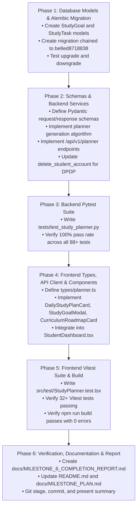

# Project Campus — Milestone 6 Implementation Plan
## Study Planner & Learning Roadmap

**Document Version:** 1.0.0  
**Status:** PROPOSED & READY FOR STAKEHOLDER REVIEW (PLANNING ONLY)  
**Author / Role:** Educational Platform Architect & Full-Stack Lead  
**Baseline Git Commit:** `39beb65` (`feat(milestone-5): implement student progress tracking and learning analytics`)  
**Target Milestone:** Milestone 6 — Study Planner & Learning Roadmap  

---

## 1. Executive Summary

Milestone 6 introduces an intelligent, curriculum-aware **Study Planner & Learning Roadmap** to Project Campus. Over Milestones 1 through 5, Project Campus established a robust foundation consisting of authenticated student onboarding, structured curriculum lessons, mathematical typesetting, interactive topic assessments, persisted lesson progress, and real-time learning analytics.

However, students currently face an unstructured academic experience: they must manually navigate through subjects, chapters, and topics, decide what to read next, guess how many practice drills will fit into their study time, and remember which weak topics require revision.

The objective of Milestone 6 is to bridge this gap by delivering a **deterministic, explainable, time-budgeted study planning engine** that translates a student's high-level academic goals into an actionable daily learning roadmap.

### Core Architectural Principles for Milestone 6:
1. **Grounded in Genuine System Data:** The planner does not invent arbitrary tasks or hypothetical schedules. It derives daily tasks directly from verified curriculum structures, published lessons, active student progress (`LessonProgress`), and atomic practice performance analytics (`question_attempts`).
2. **Zero Opaque AI / LLM Dependencies:** In strict compliance with project constraints, task generation and roadmap sequencing are 100% deterministic, rule-based, and explainable. No paid external AI APIs or cloud scheduling services are required.
3. **Non-Punitive Rescheduling & Anti-Snowball Policy:** If a student misses a planned study day, the platform never punishes them by accumulating an overwhelming mountain of overdue tasks. Instead, it rolling-adapts forward: past uncompleted tasks are cleanly cleared from overdue status, and the next plan is freshly synthesized against the student's *actual current state*.
4. **Time-Budgeted Realism:** Every planned task carries an estimated duration based on lesson reading times and standardized practice drill lengths, ensuring that the total daily workload fits comfortably within the student's declared daily availability (e.g., 60–120 minutes).
5. **Clear Separation Between Study and Revision:** Revising a topic through deliberate practice reinforces mastery and updates practice analytics, but never mutates, rolls back, or invalidates prior `LessonProgress.COMPLETED` achievements.

---

## 2. Verified Repository State

### 2.1. Version Control & Workspace
* **Current Git Commit:** `39beb65`
* **Current Branch:** `master`
* **Working Tree:** Clean (verified with `git status` — zero unstaged or untracked changes)
* **Preceding Milestone 5 Implementation:** Verified and committed at `39beb65`.

### 2.2. Runtime Environment & Toolchain
* **Backend:** Python 3.14.3, FastAPI 0.115+, SQLAlchemy 2.0.48 (asyncio), Pydantic 2.12.5, Alembic 1.18.3, Pytest 9.1.1
* **Frontend:** Node.js v25.8.0, npm 11.16.0, React 18.3.1, TypeScript 5.5.3, Vite 5.4.21, Tailwind CSS 3.4.11, Vitest 4.1.11, Lucide React 0.441.0
* **Persistence & Dialects:** SQLite via `aiosqlite` for local development (`project_campus_dev.db`), PostgreSQL 16+ via `asyncpg` as production target
* **Current Alembic Head:** `be8ed8718838` (`be8ed8718838_milestone_5_lesson_progress.py`)

### 2.3. Automated Test Baseline
* **Backend Test Suite:** **78/78 passing** (`pytest -v`), 100% success rate across authentication, authorization, taxonomy, content viewer, assessment engine, practice audits, progress tracking, and learning analytics.
* **Frontend Test Suite:** **27/27 passing** across 8 test suites (`vitest run --run`), 100% success rate.
* **Production Build:** `npm run build` (`tsc && vite build`) compiles with **zero TypeScript errors** and generates optimized production bundles.

---

## 3. Existing Features & Code Paths to Reuse

Milestone 6 will directly build upon and reuse existing domain entities and services:

1. **Student Profile & Academic Context (`StudentProfile`):**
   * Located at [`backend/app/models/identity.py`](file:///c:/Users/LOQ/OneDrive/Desktop/project_campus/backend/app/models/identity.py#L97-L151).
   * Already captures `daily_study_goal_minutes`, `target_exam_year`, `target_curriculum_id`, `grade_stage_id`, and enrolled subjects via [`StudentProfileSubject`](file:///c:/Users/LOQ/OneDrive/Desktop/project_campus/backend/app/models/identity.py#L153-L179).
   * Provides the default daily time budget and curriculum filtering boundary.

2. **Lesson Reading Progress (`LessonProgress`):**
   * Located at [`backend/app/models/content.py`](file:///c:/Users/LOQ/OneDrive/Desktop/project_campus/backend/app/models/content.py#L152-L200).
   * Provides exact status (`IN_PROGRESS`, `COMPLETED`), `started_at`, `completed_at`, and `last_accessed_at`.
   * Unfinished lessons (`IN_PROGRESS`) will be automatically prioritized as `RESUME_LESSON` tasks.

3. **Dynamic Practice Analytics & Topic Classification:**
   * Located at [`backend/app/api/v1/endpoints/analytics.py`](file:///c:/Users/LOQ/OneDrive/Desktop/project_campus/backend/app/api/v1/endpoints/analytics.py#L190-L299).
   * Evaluates topic performance into 4 deterministic categories:
     * `NEEDS_REVIEW`: $\ge 5$ attempts, observed accuracy $< 60\%$ $\rightarrow$ triggers `REVISE_TOPIC` task.
     * `INSUFFICIENT_DATA`: 1 to 4 attempts $\rightarrow$ triggers `PRACTICE_TOPIC` (5-question confidence drill).
     * `DEVELOPING`: $\ge 5$ attempts, $60\% \le \text{accuracy} < 80\%$.
     * `STRONG`: $\ge 5$ attempts, $\text{accuracy} \ge 80\%$.

4. **Curriculum Hierarchy & Publication Gating:**
   * Located at [`backend/app/models/taxonomy.py`](file:///c:/Users/LOQ/OneDrive/Desktop/project_campus/backend/app/models/taxonomy.py) and [`backend/app/models/content.py`](file:///c:/Users/LOQ/OneDrive/Desktop/project_campus/backend/app/models/content.py).
   * Content status gating ensures that only `PUBLISHED` lessons and questions are included.
   * Natural pedagogical ordering via `Chapter.chapter_number`, `Topic.display_order`, and `Lesson.display_order`.

5. **Authentication, Role Guards & DPDP Account Erasure:**
   * `require_role("STUDENT")` dependency from [`backend/app/api/deps.py`](file:///c:/Users/LOQ/OneDrive/Desktop/project_campus/backend/app/api/deps.py).
   * Account deletion cascading in [`backend/app/api/v1/endpoints/student.py`](file:///c:/Users/LOQ/OneDrive/Desktop/project_campus/backend/app/api/v1/endpoints/student.py#L233-L255).

---

## 4. Current Limitations & Technical Debt

Prior to Milestone 6, the application exhibits several planning gaps:
1. **No Persisted Task Schedule:** While `GET /api/v1/student/analytics/recommendations` provides 4 real-time suggestion pills, these are transient recommendation objects. A student cannot view "Today's Schedule", check off completed tasks, or view what was planned for previous days.
2. **Lack of Time Budgeting in Daily Actions:** Recommendations do not calculate whether the suggested actions fit within the student's available daily time (e.g., suggesting three 15-minute lessons and two 20-minute drills to a student with a 30-minute goal).
3. **Absence of a Macro Learning Roadmap:** The student dashboard displays recent activity, but lacks a high-level syllabus progress roadmap showing how many chapters and topics have been mastered versus remaining in their enrolled subjects.
4. **No Handling of Missed Study Days:** If a student does not log in for three days, there is no system to gracefully realign their schedule without causing guilt or confusion.

---

## 5. Milestone 6 Goals

1. **Dedicated Study Goal Management:**
   * Allow students to establish an active `StudyGoal` defining a target completion date, target daily study minutes, preferred study days (e.g., Monday through Saturday), and optional target exam session.
2. **Curriculum-Aware Daily Plan Generation:**
   * Implement an algorithmic plan generator that creates daily `StudyTask` items fitting the student's daily time budget.
   * Support four concrete task types:
     * `RESUME_LESSON`: Finish an already-started lesson.
     * `REVISE_TOPIC`: Deliberate practice drill for a topic with demonstrated weakness (`NEEDS_REVIEW`).
     * `PRACTICE_TOPIC`: 5-question baseline confidence drill for a topic with $<5$ attempts (`INSUFFICIENT_DATA`).
     * `STUDY_LESSON`: Read and complete the next unstarted published lesson in the enrolled syllabus sequence.
3. **Interactive Daily Plan UI in Dashboard:**
   * Embed a responsive "Today's Study Plan" card directly in [`StudentDashboard.tsx`](file:///c:/Users/LOQ/OneDrive/Desktop/project_campus/frontend/src/components/dashboard/StudentDashboard.tsx).
   * Feature task check-offs, estimated time counters, subject badges, and direct one-click jump buttons ("Resume Lesson", "Start Practice", "Open Content").
4. **Curriculum Roadmap Progress Visualizer:**
   * Display overall syllabus completion percentages, completed chapters, and topic mastery status across all enrolled subjects.
5. **Predictable Rescheduling & Non-Punitive Missed-Day Policy:**
   * Automatically roll forward past incomplete tasks without accumulating an insurmountable backlog.
   * Enable explicit manual task rescheduling to future dates.
6. **DPDP Act 2023 Compliance:**
   * Ensure full cascading deletion of all `StudyGoal` and `StudyTask` records when an account is deleted.

---

## 6. Explicit Scope and Non-Goals

### In-Scope (Milestone 6):
* SQLAlchemy models `StudyGoal` and `StudyTask`.
* Alembic migration chained from `be8ed8718838`.
* Daily plan generation engine with time-budget fitting.
* Four supported task types: `RESUME_LESSON`, `REVISE_TOPIC`, `PRACTICE_TOPIC`, `STUDY_LESSON`.
* Task completion toggle and date rescheduling endpoints.
* Roadmap progress aggregation endpoint.
* Frontend `DailyStudyPlanCard`, `CurriculumRoadmapCard`, and `StudyGoalModal`.
* Pytest backend test suite (`tests/test_study_planner.py`).
* Vitest frontend test suite (`frontend/src/test/StudyPlanner.test.tsx`).
* Documentation updates in `README.md` and `docs/MILESTONE_PLAN.md`.

### Explicit Non-Goals (Strictly Deferred to Future Milestones):
* **External AI / LLM APIs:** No AI chat, prompt generation, or LLM-driven scheduling (deferred to Milestone 6/7 as per roadmap).
* **SuperMemo SM-2 Interval Calculation:** No automated mathematical interval expansion ($1, 3, 7, 21$ days) or question-level review queues (deferred to Milestone 7: Spaced Repetition).
* **External Notification Gateways:** No push notifications, SMS alerts, email reminders, or cron daemon background processes (remains self-contained within request/response cycles).
* **Third-Party Calendar Integration:** No Google Calendar, Apple iCal, or Outlook sync.
* **Social / Gamification Mechanics:** No public leaderboards, XP points, streaks, or badges.
* **Content Creation / CMS:** No admin interfaces for editing curriculum.

---

## 7. User Stories

1. **US-1: Daily Structured Guidance**  
   * *As an authenticated student*, I want to open my dashboard each day and see a clear, prioritized list of 2 to 4 learning tasks that fit into my daily available study time (e.g., 60 minutes), so that I know exactly what to do without decision fatigue.
2. **US-2: Seamless Lesson Resumption**  
   * *As a student who stopped halfway through a lesson yesterday*, I want my daily study plan to immediately prompt me to resume and complete that lesson before asking me to start new concepts.
3. **US-3: Targeted Conceptual Revision**  
   * *As a student who achieved $<60\%$ accuracy on Gauss's Law questions*, I want my study plan to schedule a 15-minute practice session on Gauss's Law, so that I can repair my weak area before moving forward.
4. **US-4: Low-Guilt Missed Day Recovery**  
   * *As a student who was unwell or busy with school exams yesterday*, I want the planner to adapt forward when I return today rather than showing an overwhelming pile of overdue tasks that discourages me from studying.
5. **US-5: Flexible Availability Adjustment**  
   * *As a student whose weekend study time increases to 180 minutes*, I want to adjust my daily target time and have my plan immediately offer additional syllabus tasks to fill the available time.
6. **US-6: Macroscopic Syllabus Roadmap**  
   * *As a student preparing for board exams*, I want to see an overview of my enrolled subjects showing how many chapters and topics I have completed, so that I can gauge my pace against my target exam year.

---

## 8. Proposed Database Model & Relationships

### 8.1. Architectural Evaluation: Flat Tasks vs. Plan Header Table
Before defining the schema, we evaluate two viable modeling options:

* **Option A: Two-Table Header/Detail Pattern (`study_plans` + `study_tasks`)**  
  * Each day has a parent row `study_plans(id, user_id, plan_date, target_minutes)` and children `study_tasks(id, plan_id, ...)`.
  * *Trade-off:* Introduces extra join overhead and foreign key cascading complexity. If a task is rescheduled to tomorrow, moving it requires updating the parent `plan_id` or creating tomorrow's header row prematurely.
* **Option B: Goal + Flat Scheduled Tasks Pattern (`study_goals` + `study_tasks`) — RECOMMENDED**  
  * `study_goals`: Captures the student's active overarching commitment (target date, daily minutes, preferred days).
  * `study_tasks`: Captures individual planned activities with a direct `scheduled_date: Date` column, indexed by `(user_id, scheduled_date)`.
  * *Rationale:* Dramatically simpler. Querying today's tasks is a direct single-table index seek: `SELECT * FROM study_tasks WHERE user_id = :uid AND scheduled_date = :today`. Rescheduling a task to tomorrow is a simple single-field update: `scheduled_date = :new_date`.

### 8.2. Entity 1: `StudyGoal` (Table: `study_goals`)
Stores the student's active academic preparation goal and time commitment.

| Column | Type | Constraints / Description |
| :--- | :--- | :--- |
| `id` | `UUID` | Primary Key, default `uuid.uuid4` |
| `user_id` | `UUID` | Foreign Key (`users.id`, `ON DELETE CASCADE`), Indexed, Nullable=False |
| `title` | `String(150)` | Title of goal, e.g., `"CBSE Class 12 Science Preparation"` |
| `target_date` | `Date` | Optional target exam or milestone date (e.g., `2027-03-01`) |
| `daily_study_minutes` | `Integer` | Daily commitment in minutes (default: 120, range: 15–480) |
| `preferred_days` | `JSON` | List of active study days, default: `["MON","TUE","WED","THU","FRI","SAT","SUN"]` |
| `status` | `String(20)` | `ACTIVE`, `PAUSED`, `COMPLETED`, `ARCHIVED` (default: `ACTIVE`) |
| `created_at` | `DateTime(timezone=True)` | Creation timestamp |
| `updated_at` | `DateTime(timezone=True)` | Modification timestamp |

**Indexes & Constraints:**
* `idx_study_goals_user_status` on `(user_id, status)`

### 8.3. Entity 2: `StudyTask` (Table: `study_tasks`)
Stores granular scheduled study activities.

| Column | Type | Constraints / Description |
| :--- | :--- | :--- |
| `id` | `UUID` | Primary Key, default `uuid.uuid4` |
| `user_id` | `UUID` | Foreign Key (`users.id`, `ON DELETE CASCADE`), Indexed, Nullable=False |
| `goal_id` | `UUID` | Foreign Key (`study_goals.id`, `ON DELETE SET NULL`), Nullable=True, Indexed |
| `scheduled_date` | `Date` | Calendar date for which the task is scheduled, Nullable=False, Indexed |
| `task_type` | `String(30)` | Enum: `STUDY_LESSON`, `RESUME_LESSON`, `PRACTICE_TOPIC`, `REVISE_TOPIC` |
| `title` | `String(255)` | Descriptive task title (e.g., `"Study: Electric Charges and Fields"`) |
| `subject_id` | `UUID` | Foreign Key (`subjects.id`, `ON DELETE SET NULL`), Nullable=True |
| `subject_name` | `String(100)` | Cached display name of subject (e.g., `"Physics"`) |
| `chapter_id` | `UUID` | Foreign Key (`chapters.id`, `ON DELETE SET NULL`), Nullable=True |
| `topic_id` | `UUID` | Foreign Key (`topics.id`, `ON DELETE SET NULL`), Nullable=True |
| `lesson_id` | `UUID` | Foreign Key (`lessons.id`, `ON DELETE SET NULL`), Nullable=True |
| `estimated_minutes` | `Integer` | Workload estimate (e.g., 10–20 mins, default: 15) |
| `status` | `String(20)` | `PENDING`, `COMPLETED`, `SKIPPED`, `RESCHEDULED` (default: `PENDING`) |
| `is_completed` | `Boolean` | Boolean completion flag (default: `False`, Indexed) |
| `completed_at` | `DateTime(timezone=True)` | Nullable timestamp when completed |
| `display_order` | `Integer` | Execution sequence index within the day (default: 0) |
| `reason` | `String(255)` | Transparent pedagogical reason explaining why this task was chosen |
| `created_at` | `DateTime(timezone=True)` | Creation timestamp |
| `updated_at` | `DateTime(timezone=True)` | Modification timestamp |

**Indexes & Constraints:**
* `idx_study_tasks_user_date` on `(user_id, scheduled_date)`
* `idx_study_tasks_user_status` on `(user_id, is_completed)`
* Composite index `idx_study_tasks_lookup` on `(user_id, scheduled_date, is_completed)`

---

## 9. Migration Strategy

* **Current Migration Head:** `be8ed8718838` ([`backend/alembic/versions/be8ed8718838_milestone_5_lesson_progress.py`](file:///c:/Users/LOQ/OneDrive/Desktop/project_campus/backend/alembic/versions/be8ed8718838_milestone_5_lesson_progress.py))
* **New Migration Identifier:** Generated via Alembic CLI (e.g., `c1a2e3f4b5d6_milestone_6_study_planner.py`).
* **Down Revision:** Explicitly points to `be8ed8718838`.
* **Zero Disruption to Existing Data:**
  * No existing tables or columns will be altered or dropped.
  * Local development database (`project_campus_dev.db`) will retain all existing 18 tables, student accounts, curriculum taxonomy, lessons, question bank, and practice attempts intact.
* **Dual-Dialect SQL Safety:**
  * Uses Alembic's `batch_alter_table` context for SQLite compatibility.
  * Explicitly uses `sa.Uuid(as_uuid=True)` for primary/foreign keys across PostgreSQL and SQLite.
  * Bidirectional verification: Migration will be verified by running `alembic downgrade -1` followed by `alembic upgrade head`.

---

## 10. API Endpoint Specifications

All planner endpoints will be grouped under the prefix `/api/v1/planner` and mounted in [`backend/app/api/v1/api.py`](file:///c:/Users/LOQ/OneDrive/Desktop/project_campus/backend/app/api/v1/api.py).

### 10.1. Study Goal Endpoints

#### `GET /api/v1/planner/goal`
* **Purpose:** Retrieve the active student's current study goal. If none exists, creates a default goal derived from `StudentProfile` preferences.
* **Auth:** Required `STUDENT` role.
* **Response (200 OK):** `StudyGoalResponse`
  ```json
  {
    "id": "3fa85f64-5717-4562-b3fc-2c963f66afa6",
    "user_id": "7ca85f64-5717-4562-b3fc-2c963f66afa1",
    "title": "CBSE Class 12 Preparation",
    "target_date": "2027-03-01",
    "daily_study_minutes": 120,
    "preferred_days": ["MON", "TUE", "WED", "THU", "FRI", "SAT"],
    "status": "ACTIVE",
    "created_at": "2026-10-16T10:00:00Z",
    "updated_at": "2026-10-16T10:00:00Z"
  }
  ```

#### `POST /api/v1/planner/goal`
* **Purpose:** Create or update the active study goal.
* **Auth:** Required `STUDENT` role.
* **Request Body:** `StudyGoalCreateRequest`
  ```json
  {
    "title": "Intensive JEE Prep",
    "target_date": "2027-05-15",
    "daily_study_minutes": 150,
    "preferred_days": ["MON", "TUE", "WED", "THU", "FRI", "SAT", "SUN"]
  }
  ```
* **Validation:** `daily_study_minutes` must be between 15 and 480. `target_date` must be today or in the future.
* **Response (200 OK / 201 Created):** `StudyGoalResponse`

---

### 10.2. Daily Plan & Task Endpoints

#### `GET /api/v1/planner/daily`
* **Purpose:** Retrieve planned tasks for a given date.
* **Query Parameters:** `plan_date` (ISO date, optional; defaults to server current date in UTC/local timezone).
* **Auth:** Required `STUDENT` role.
* **Behavior:**
  * Queries `study_tasks` for `user_id == current_user.id` and `scheduled_date == plan_date`.
  * If no tasks exist for `plan_date` and `plan_date == today`, automatically invokes the planner generator to create today's initial plan idempotently.
* **Response (200 OK):** `DailyStudyPlanResponse`
  ```json
  {
    "date": "2026-10-16",
    "target_minutes": 120,
    "planned_minutes": 45,
    "completed_minutes": 15,
    "is_fully_completed": false,
    "tasks": [
      {
        "id": "task-uuid-1",
        "task_type": "RESUME_LESSON",
        "title": "Coulomb's Law and Electrostatic Force",
        "subject_name": "Physics",
        "lesson_id": "lesson-uuid-1",
        "topic_id": "topic-uuid-1",
        "estimated_minutes": 15,
        "status": "COMPLETED",
        "is_completed": true,
        "completed_at": "2026-10-16T09:30:00Z",
        "display_order": 1,
        "reason": "You opened this lesson recently. Finish it to complete the conceptual foundation."
      },
      {
        "id": "task-uuid-2",
        "task_type": "REVISE_TOPIC",
        "title": "Practice: Electric Flux and Gauss's Law",
        "subject_name": "Physics",
        "topic_id": "topic-uuid-2",
        "lesson_id": null,
        "estimated_minutes": 15,
        "status": "PENDING",
        "is_completed": false,
        "completed_at": null,
        "display_order": 2,
        "reason": "Observed accuracy is 50.0% across 6 questions. Dedicated practice is recommended."
      },
      {
        "id": "task-uuid-3",
        "task_type": "STUDY_LESSON",
        "title": "Electric Dipole and Dipole Moment",
        "subject_name": "Physics",
        "lesson_id": "lesson-uuid-3",
        "topic_id": "topic-uuid-3",
        "estimated_minutes": 15,
        "status": "PENDING",
        "is_completed": false,
        "completed_at": null,
        "display_order": 3,
        "reason": "Next published lesson in your enrolled Physics curriculum sequence."
      }
    ]
  }
  ```

#### `POST /api/v1/planner/daily/generate`
* **Purpose:** Explicitly regenerate or refresh the study plan for a given date.
* **Query Parameters:** `plan_date` (date, default: today), `force_refresh` (boolean, default: false).
* **Behavior:**
  * If tasks already exist for that date and `force_refresh == False`, returns existing tasks.
  * If `force_refresh == True`, retains already `COMPLETED` tasks, deletes uncompleted `PENDING` tasks, and fills the remaining daily minute budget with newly evaluated recommendations.
* **Response (200 OK):** `DailyStudyPlanResponse`

#### `PATCH /api/v1/planner/tasks/{task_id}/complete`
* **Purpose:** Mark a study task as completed or toggle completion.
* **Auth:** Required `STUDENT` role.
* **IDOR Protection:** Validates that `task.user_id == current_user.id` (returns 404 if not found or unauthorized).
* **Request Body:** `TaskCompleteRequest`
  ```json
  {
    "is_completed": true
  }
  ```
* **Behavior:**
  * Sets `is_completed = true`, `status = "COMPLETED"`, `completed_at = now()`.
  * If `is_completed == false`, reverts `status = "PENDING"`, `completed_at = null`.
* **Response (200 OK):** `StudyTaskResponse`

#### `PATCH /api/v1/planner/tasks/{task_id}/reschedule`
* **Purpose:** Move a pending task to another date.
* **Auth:** Required `STUDENT` role.
* **IDOR Protection:** Validates that `task.user_id == current_user.id`.
* **Request Body:** `TaskRescheduleRequest`
  ```json
  {
    "new_date": "2026-10-17"
  }
  ```
* **Validation:** `new_date` cannot be in the past. Completed tasks cannot be rescheduled (returns 400 Bad Request).
* **Behavior:** Updates `scheduled_date = new_date`, `status = "RESCHEDULED"` or `"PENDING"`.
* **Response (200 OK):** `StudyTaskResponse`

---

### 10.3. Curriculum Roadmap Endpoint

#### `GET /api/v1/planner/roadmap`
* **Purpose:** Retrieve macroscopic curriculum progress across all enrolled subjects.
* **Auth:** Required `STUDENT` role.
* **Response (200 OK):** `CurriculumRoadmapResponse`
  ```json
  {
    "total_lessons_count": 24,
    "completed_lessons_count": 6,
    "overall_completion_percentage": 25.0,
    "subjects": [
      {
        "subject_id": "sub-phy-uuid",
        "subject_name": "Physics",
        "total_lessons": 12,
        "completed_lessons": 4,
        "in_progress_lessons": 1,
        "completion_percentage": 33.3,
        "chapters": [
          {
            "chapter_id": "chap-1-uuid",
            "chapter_number": 1,
            "title": "Electric Charges and Fields",
            "total_lessons": 3,
            "completed_lessons": 3,
            "is_completed": true
          },
          {
            "chapter_id": "chap-2-uuid",
            "chapter_number": 2,
            "title": "Electrostatic Potential and Capacitance",
            "total_lessons": 4,
            "completed_lessons": 1,
            "is_completed": false
          }
        ]
      }
    ]
  }
  ```

---

## 11. Planner Generation & Rescheduling Rules

### 11.1. Deterministic Task Selection Algorithm
The planner uses a bounded, priority-driven greedy filling algorithm:

```
Algorithm GenerateDailyPlan(user_id, plan_date):
  1. Fetch active StudyGoal for user_id (fallback to StudentProfile.daily_study_goal_minutes).
  2. Set TargetBudget = StudyGoal.daily_study_minutes (e.g. 120 mins).
  3. Set AccumulatedMinutes = 0.
  4. Initialize ScheduledTasks = [].
  5. Fetch EnrolledSubjectIds from StudentProfileSubject.

  // Priority 1: Resume In-Progress Lessons
  6. Query LessonProgress WHERE user_id == user_id AND status == 'IN_PROGRESS'
       JOIN Lesson ON status == 'PUBLISHED'
       ORDER BY last_accessed_at DESC.
  7. For each in-progress lesson:
       If AccumulatedMinutes + lesson.estimated_read_time_minutes <= TargetBudget:
         AddTask(ScheduledTasks, 'RESUME_LESSON', lesson, lesson.estimated_read_time_minutes)
         AccumulatedMinutes += lesson.estimated_read_time_minutes
       If AccumulatedMinutes >= TargetBudget: Return ScheduledTasks.

  // Priority 2: Revise Struggling Topics (NEEDS_REVIEW)
  8. Query topic analytics for user_id WHERE status_category == 'NEEDS_REVIEW'
       ORDER BY observed_accuracy_percentage ASC.
  9. For each struggling topic:
       If topic.id not already scheduled and AccumulatedMinutes + 15 <= TargetBudget:
         AddTask(ScheduledTasks, 'REVISE_TOPIC', topic, 15)
         AccumulatedMinutes += 15
       If AccumulatedMinutes >= TargetBudget: Return ScheduledTasks.

  // Priority 3: Establish Baseline on Insufficient Data Topics
  10. Query topic analytics for user_id WHERE status_category == 'INSUFFICIENT_DATA' AND attempts > 0.
  11. For each low-confidence topic:
        If topic.id not already scheduled and AccumulatedMinutes + 15 <= TargetBudget:
          AddTask(ScheduledTasks, 'PRACTICE_TOPIC', topic, 15)
          AccumulatedMinutes += 15
        If AccumulatedMinutes >= TargetBudget: Return ScheduledTasks.

  // Priority 4: Progress to Next Unstarted Published Lesson in Syllabus Sequence
  12. Fetch all completed and started lesson IDs for user_id.
  13. Query published lessons in enrolled subjects
        ORDER BY Chapter.chapter_number ASC, Topic.display_order ASC, Lesson.display_order ASC.
  14. For each lesson:
        If lesson.id not in completed_or_started and lesson.id not already scheduled:
          If AccumulatedMinutes + lesson.estimated_read_time_minutes <= TargetBudget or len(ScheduledTasks) == 0:
            AddTask(ScheduledTasks, 'STUDY_LESSON', lesson, lesson.estimated_read_time_minutes)
            AccumulatedMinutes += lesson.estimated_read_time_minutes
          If AccumulatedMinutes >= TargetBudget: Break.

  15. Save ScheduledTasks to database with scheduled_date = plan_date.
  16. Return ScheduledTasks.
```

### 11.2. Non-Punitive Missed-Day Policy
To protect student motivation, the system enforces a strict **anti-snowball rule**:
* If `plan_date == today`:
  * Tasks scheduled for *past dates* (`scheduled_date < today`) that are still `is_completed == False` are marked with `status = "SKIPPED"` or cleanly archived.
  * Past uncompleted tasks do **not** roll into today's list as overdue penalties.
  * Instead, because Priority 1, 2, and 4 dynamically re-read the student's *live* progress state, any uncompleted lesson or struggling topic is naturally selected in today's fresh plan if it still warrants study.

---

## 12. Recommendation and Prioritization Logic

* **Explainability Requirement:** Every generated `StudyTask` must contain a human-readable `reason` string explaining *why* it is scheduled.
  * `RESUME_LESSON`: `"You started this lesson recently. Finish it to complete the concept foundation."`
  * `REVISE_TOPIC`: `"Observed accuracy is {accuracy}% across {attempts} questions. Practice recommended to strengthen concept."`
  * `PRACTICE_TOPIC`: `"You have answered {attempts} questions. Complete a 5-question drill to establish a performance baseline."`
  * `STUDY_LESSON`: `"Next structured lesson in your enrolled {subject_name} syllabus sequence."`
* **Handling Insufficient Data:** Topics with zero attempts are never falsely labeled "Weak". They remain in the curriculum sequence to be studied in normal syllabus order.
* **Independence of Lesson vs. Revision Records:** Completing a `REVISE_TOPIC` task records a practice session and updates question attempts, but never mutates the original `LessonProgress` record of that topic's lessons.

---

## 13. Frontend Component Plan

### 13.1. New Components to Create
1. [`frontend/src/components/planner/DailyStudyPlanCard.tsx`](file:///c:/Users/LOQ/OneDrive/Desktop/project_campus/frontend/src/components/planner/DailyStudyPlanCard.tsx):
   * Primary daily study module embedded on the dashboard.
   * Header: Shows current selected date, day of week, and daily progress bar (e.g., "30 / 60 min completed").
   * Task items: Checkbox toggle, task type badge, subject label, estimated minutes, title, reason, and direct action button:
     * `RESUME_LESSON` / `STUDY_LESSON` $\rightarrow$ calls `onSelectLesson(lesson_id)`.
     * `REVISE_TOPIC` / `PRACTICE_TOPIC` $\rightarrow$ calls `onStartPractice(topic_id, topic_title)`.
   * Date navigation pill bar: Allows viewing Yesterday, Today, Tomorrow.
   * Empty state for rest days or zero tasks with "Generate Study Plan" button.
   * Completion celebration state with motivational message when all daily tasks are checked off.
2. [`frontend/src/components/planner/CurriculumRoadmapCard.tsx`](file:///c:/Users/LOQ/OneDrive/Desktop/project_campus/frontend/src/components/planner/CurriculumRoadmapCard.tsx):
   * Visual macro-roadmap displaying syllabus progress.
   * Subject tabs (e.g. Physics, Chemistry, Math).
   * Progress bar with percentage, completed/total lessons ratio.
   * Chapter accordion showing topic status badges (`Completed`, `In Progress`, `Needs Review`, `Unstarted`).
3. [`frontend/src/components/planner/StudyGoalModal.tsx`](file:///c:/Users/LOQ/OneDrive/Desktop/project_campus/frontend/src/components/planner/StudyGoalModal.tsx):
   * Interactive modal allowing student to adjust their target exam date, target daily study minutes (interactive slider: 15–300 min), and active study days checkboxes.
4. [`frontend/src/types/planner.ts`](file:///c:/Users/LOQ/OneDrive/Desktop/project_campus/frontend/src/types/planner.ts):
   * TypeScript interfaces for `StudyGoal`, `StudyTask`, `DailyStudyPlan`, `CurriculumRoadmap`, `TaskType`, `TaskStatus`.

### 13.2. Existing Components to Update
* [`frontend/src/components/dashboard/StudentDashboard.tsx`](file:///c:/Users/LOQ/OneDrive/Desktop/project_campus/frontend/src/components/dashboard/StudentDashboard.tsx):
  * Mount `DailyStudyPlanCard` directly below the 5-KPI analytics bar.
  * Connect `onSelectLesson` and `onStartPractice` to handle one-click task execution.
  * Mount `CurriculumRoadmapCard` adjacent to or integrated within the Topic Performance Matrix.
  * Connect Goal adjust button in Card 3 to open `StudyGoalModal`.
* [`frontend/src/services/api.ts`](file:///c:/Users/LOQ/OneDrive/Desktop/project_campus/frontend/src/services/api.ts):
  * Add API client methods: `getStudyGoal`, `updateStudyGoal`, `getDailyStudyPlan`, `generateDailyStudyPlan`, `toggleTaskComplete`, `rescheduleTask`, `getCurriculumRoadmap`.

---

## 14. Authentication, Authorization, Privacy & DPDP Compliance

1. **Authentication:** All `/api/v1/planner/*` endpoints require a valid Bearer JWT and the `STUDENT` role.
2. **Strict Server-Side IDOR Immunity:**
   * Every query filters strictly by `user_id == current_user.id`.
   * Path parameters like `task_id` are validated against `current_user.id`; accessing another student's task returns `404 Not Found`.
3. **Published Content Security:**
   * Tasks are never generated for unpublished, draft, or archived lessons or topics.
4. **DPDP Act 2023 Compliance & Cascading Data Erasure:**
   * Update [`backend/app/api/v1/endpoints/student.py`](file:///c:/Users/LOQ/OneDrive/Desktop/project_campus/backend/app/api/v1/endpoints/student.py#L233-L255):
     ```python
     await db.execute(delete(StudyTask).where(StudyTask.user_id == current_user.id))
     await db.execute(delete(StudyGoal).where(StudyGoal.user_id == current_user.id))
     ```
   * Ensures that exercising the right to erasure permanently and completely purges all scheduled tasks and goals from the database.
5. **Privacy Review Consideration:**
   * Study tasks and completion timestamps are classified as private educational activity data. They must never be exposed through public profiles or unsecured endpoints.

---

## 15. Backend Testing Plan (`tests/test_study_planner.py`)

1. `test_get_or_create_default_study_goal`: Verifies that querying `/planner/goal` creates a sensible default goal from profile preferences if none exists.
2. `test_update_study_goal_validation`: Verifies updating daily study minutes, target dates, and preferred days, rejecting invalid bounds (<15 min or past dates).
3. `test_generate_daily_plan_time_budget_adherence`: Confirms that generated tasks do not exceed the student's declared daily minute budget.
4. `test_priority_1_resume_in_progress_lesson`: Verifies that an `IN_PROGRESS` lesson is scheduled as the first task (`RESUME_LESSON`).
5. `test_priority_2_revise_struggling_topic`: Verifies that a topic with $\ge 5$ attempts and $<60\%$ accuracy triggers a `REVISE_TOPIC` task.
6. `test_priority_4_next_unstarted_lesson`: Verifies that the next unstarted lesson in syllabus sequence is scheduled.
7. `test_task_completion_toggle_and_timestamp`: Verifies toggling task completion, setting and clearing `completed_at` timestamps.
8. `test_task_reschedule_to_future_date`: Verifies rescheduling pending tasks to tomorrow, rejecting past dates and completed tasks.
9. `test_missed_day_non_punitive_behavior`: Verifies that past uncompleted tasks are skipped/archived and today's plan is cleanly generated without backlog snowballs.
10. `test_published_content_restriction`: Verifies draft and in-review lessons are never included in planned tasks.
11. `test_planner_idor_student_data_isolation`: Confirms Student A cannot view, complete, or reschedule Student B's study tasks.
12. `test_account_erasure_cascades_study_planner`: Confirms deleting student account permanently deletes all `StudyTask` and `StudyGoal` rows.

---

## 16. Frontend Testing Plan (`frontend/src/test/StudyPlanner.test.tsx`)

1. `renders daily study plan card with tasks, estimated minutes, and progress bar`: Verifies task listing, badges, and workload indicators.
2. `handles task completion toggle with optimistic update`: Simulates clicking task completion checkbox, verifying API dispatch and visual strike-through/checked state.
3. `renders celebratory state when all daily tasks are completed`: Verifies congratulatory feedback banner when 100% of tasks are completed.
4. `handles task action click to jump to lesson viewer or practice modal`: Verifies that clicking "Resume Lesson" triggers `onSelectLesson`.
5. `renders study goal adjustment modal and updates goal`: Verifies slider adjustment and save interaction.
6. `renders curriculum roadmap card with subject and chapter completion percentages`: Verifies roadmap rendering.
7. `displays empty state gracefully when no tasks are scheduled for the day`: Verifies "Generate Study Plan" CTA on empty days.

---

## 17. Migration and Database Compatibility Testing

1. **Alembic Upgrade/Downgrade Integrity:**
   * Execute `alembic upgrade head`.
   * Verify table creation in SQLite: `study_goals`, `study_tasks`.
   * Execute `alembic downgrade -1`.
   * Verify clean removal of tables without foreign key constraint errors.
   * Re-execute `alembic upgrade head`.
2. **PostgreSQL Compatibility Review:**
   * Verify that UUID columns, foreign key `ON DELETE CASCADE`, and timestamps adhere strictly to PostgreSQL dialect standards without SQLite-specific syntax hacks.

---

## 18. Error Handling and Edge Cases

| Edge Case | Expected System Behavior |
| :--- | :--- |
| **Student has zero enrolled subjects** | Daily plan gracefully suggests completing onboarding or enrolled subjects setup; does not crash. |
| **All published lessons already completed** | Daily plan fills time with revision practice drills and maintenance quizzes rather than attempting to fetch nonexistent lessons. |
| **Zero practice attempts recorded (Fresh student)** | No struggling topics are assumed; plan schedules initial reading lessons (`STUDY_LESSON`) to start their journey. |
| **Student available time is very short (e.g., 15 mins)** | Plan schedules exactly one 10–15 min lesson or drill; does not overflow budget. |
| **Student reschedules task to a past date** | API rejects request with `400 Bad Request` (`"Rescheduled date cannot be in the past"`). |
| **Student attempts to reschedule an already completed task** | API rejects request with `400 Bad Request` (`"Completed tasks cannot be rescheduled"`). |
| **Lesson referenced by task is unpublished by educator** | Dynamic lookup detects unpublishing; task is gracefully omitted or flagged as unavailable with 404 guard. |

---

## 19. Acceptance Criteria

1. **Database Schema:** `study_goals` and `study_tasks` tables created via a clean, reversible Alembic migration chained from `be8ed8718838`.
2. **Goal Management:** Student can view and adjust their daily study minute goal and target exam date via API and UI modal.
3. **Daily Plan Generation:** Calling `/planner/daily` returns a prioritized, time-budgeted list of tasks tailored to the student's progress and weakness areas.
4. **Task Completion:** Students can check off tasks with immediate visual and persisted database confirmation.
5. **Rescheduling:** Students can move tasks forward to future dates without penalty.
6. **Roadmap Progress:** Students can view chapter and subject completion meters in their academic workspace.
7. **DPDP Compliance:** Deleting a student account permanently deletes all associated goals and tasks.
8. **Automated Verification:**
   * All existing 78 backend tests continue to pass (0 regressions).
   * Minimum of 10 new backend tests pass for planner functionality (total $\ge 88$ backend tests).
   * All existing 27 frontend tests continue to pass (0 regressions).
   * Minimum of 5 new frontend tests pass for planner components (total $\ge 32$ frontend tests).
   * `npm run build` succeeds cleanly with 0 TypeScript compilation errors.

---

## 20. Ordered Implementation Phases

When approved by the stakeholder, Milestone 6 will be executed in the following strict order:



---

## 21. Risks and Mitigations

| Risk | Impact | Likelihood | Mitigation Strategy |
| :--- | :---: | :---: | :--- |
| **Timezone Discrepancies:** Student local day differs from server UTC date. | Low | Medium | Client passes optional `client_date` (ISO `YYYY-MM-DD`) parameter; server falls back to UTC. |
| **Cognitive Overload:** Too many tasks generated, overwhelming the student. | High | Low | Hard ceiling of maximum 4 tasks per day regardless of study budget. |
| **Content Exhaustion:** Student completes all available lessons in enrolled subjects. | Medium | Low | Planner falls back to spaced revision drills and maintenance practice. |
| **Accidental State Drift:** Re-generating plan overwrites already completed tasks. | High | Low | Generator algorithm strictly preserves `COMPLETED` tasks; only modifies `PENDING` items. |

---

## 22. Estimated Complexity and Dependencies

* **Complexity Assessment:** **Medium**
  * Logic is well-bounded and deterministic.
  * Direct continuation of Milestone 5 analytics and progress models.
* **External Dependencies:** **Zero** new third-party libraries required.
  * Backend uses existing FastAPI, SQLAlchemy, Pydantic, Alembic.
  * Frontend uses existing React, Tailwind CSS, Lucide React icons.

---

## 23. Questions Requiring User Approval

Before proceeding to implementation, please confirm or provide guidance on the following architectural choices:

1. **Default Daily Study Time:** We recommend defaulting the daily study budget to **120 minutes** (with an adjustable range of 15 to 300 minutes in the UI), matching the existing `StudentProfile.daily_study_goal_minutes`. Does this default suit your target student profile?
2. **Maximum Daily Tasks Ceiling:** We propose capping daily generated tasks at a maximum of **4 tasks per day** (e.g., maximum two lessons and two practice drills) to prevent cognitive overload, even if the student sets a large daily time budget (e.g. 240 mins). Do you approve this ceiling?
3. **Past Incomplete Task Handling:** We recommend that past uncompleted tasks are automatically marked as `SKIPPED` without accumulating a punitive overdue backlog, allowing today's plan to start fresh based on current progress. Do you approve of this non-punitive forward-rolling policy?
4. **Placement on Dashboard:** We plan to place the `DailyStudyPlanCard` directly below the 5-KPI analytics bar on the `StudentDashboard`, making it the primary actionable module students see when they log in. Does this placement align with your UX vision?

---

*This plan represents a comprehensive, technically verified blueprint for Milestone 6. No application source code has been altered during this planning phase.*
