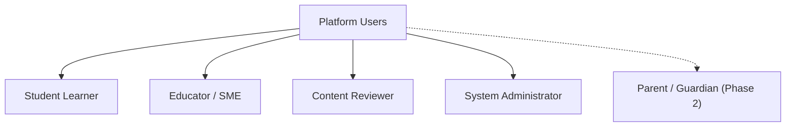

# Project Campus — Product Requirements Document (PRD)

**Document Version:** 1.0.0  
**Status:** Approved for Architecture Planning  
**Target Audience:** Engineering, Product, Pedagogy, Quality Assurance  
**Last Updated:** October 2026  

---

## 1. Executive Summary & Product Vision

**Project Campus** is a production-grade, serious educational technology platform designed to empower students through mastery-based learning, rigorous examination preparation, and intelligent academic progress tracking.

Unlike gamified entertainment apps, Project Campus focuses on deep academic comprehension, verified pedagogical accuracy, structured deliberate practice, and transparent AI support. The platform is architected to scale across diverse educational frameworks, starting with Indian secondary and higher-secondary curricula, competitive engineering/medical entrance examinations, and expanding to international curricula.

---

## 2. Core Product Principles

All architectural decisions, product designs, and engineering implementations must strictly adhere to the following ten principles:

1. **Pedagogical and Content Correctness:** Educational materials, questions, formulas, diagrams, and answer explanations must be academically verified. There is zero tolerance for misleading or fabricated solutions.
2. **Reliable Application Behavior:** System interactions—especially quiz submissions, score calculations, and progress synchronization—must be deterministic, atomic, and fail-safe.
3. **High-Value User Experience:** Clean, distraction-free typography and layouts optimized for sustained study sessions without cognitive overload.
4. **Desktop and Mobile-Browser Parity:** Full functional parity across mobile web browsers (starting at 360px viewport width) and desktop monitors.
5. **Universal Accessibility:** Strict adherence to WCAG 2.1 Level AA, including keyboard navigability, high-contrast mathematical notation, and screen-reader friendliness.
6. **Student Privacy and Data Protection:** Explicit compliance with data protection laws (such as the Digital Personal Data Protection Act, 2023). Minors' data is never commercialized, sold, or exposed to behavioral advertising.
7. **Maintainable, Testable Architecture:** Modular design with high test coverage, strict typing, and comprehensive continuous-integration checks.
8. **Transparent AI Behavior:** AI features serve as pedagogical aids rather than authoritative answer oracles. AI interactions are explicitly branded, bounded, and auditable.
9. **Strict Separation of Verified and AI Content:** Clear, visible differentiation between human-verified textbook content/solutions and dynamic AI-generated explanations.
10. **Modular, Extensible System Design:** The syllabus taxonomy, assessment engines, and user state models must allow adding new educational boards, languages, and examination formats without core refactoring.

> [!CAUTION]
> **Strict Truthfulness Guarantee:** The platform shall never fabricate educational credentials, fake institutional partnerships, synthetic user testimonials, exaggerated pass rates, or deceptive claims of guaranteed examination success.

---

## 3. Target Curricula & System Support

### Phase 1 (MVP Launch Scope)
* **Indian National Curricula:** CBSE (Central Board of Secondary Education) Classes 9 to 12.
* **Competitive Entrance Examinations:**
  * **JEE Main & Advanced:** Physics, Chemistry, Mathematics (XI & XII syllabus).
  * **NEET UG:** Physics, Chemistry, Biology (Botany & Zoology) (XI & XII syllabus).
* **Medium of Instruction:** English (with Unicode support for scientific/mathematical notation).

### Phase 2 & Future Expansion Scope
* **State Secondary & Higher Secondary Boards:** Maharashtra State Board, Karnataka KSEEB/PUC, Tamil Nadu State Board, Uttar Pradesh Madhyamik Shiksha Parishad, etc.
* **Council for the Indian School Certificate Examinations (CISCE):** ICSE (Class 9-10) and ISC (Class 11-12).
* **International Curricula:** Cambridge Assessment International Education (IGCSE & A-Levels), International Baccalaureate (IB MYP & DP).
* **Multilingual Instruction:** Hindi, Tamil, Telugu, Marathi, Bengali, and other regional languages.
* **Additional Competitive Exams:** CUET, BITSAT, State Engineering CETs, Olympiads.

---

## 4. User Personas & Roles



### 4.1. Student Learner
* **Profile:** Secondary/higher-secondary school student or competitive exam repeater.
* **Primary Goals:** Study chapter concepts, solve practice questions, diagnose weak areas, get immediate step-by-step help when stuck, and adhere to a structured revision schedule.
* **Pain Points:** Unclear solutions in textbooks, generic AI tools that hallucinate incorrect scientific formulas, poor mobile readability of complex math/chemistry symbols.

### 4.2. Subject Matter Expert (SME) / Content Author
* **Profile:** Qualified teacher or academic content developer.
* **Primary Goals:** Author curriculum-aligned chapters, construct verified question banks with LaTeX formulas, define comprehensive solution steps, and tag questions by difficulty and cognitive level (Bloom's Taxonomy).
* **Pain Points:** Clunky CMS tools with poor mathematical typesetting, lack of version control for edits.

### 4.3. Content Reviewer / Editorial QA
* **Profile:** Senior pedagogue or academic editor.
* **Primary Goals:** Review drafts submitted by authors, verify accuracy of keys and explanations, ensure zero pedagogical flaws, and publish or reject with constructive feedback.

### 4.4. Platform Administrator
* **Profile:** Engineering and operational manager.
* **Primary Goals:** Manage roles, monitor system health, inspect audit logs, and oversee user reports and errata submissions.

---

## 5. Functional Requirements Matrix

### 5.1. Module 1: Student Onboarding & Academic Profile
* **MVP-FR-1.1:** Student self-registration and login via email/password and standard OAuth (Google).
* **MVP-FR-1.2:** Mandatory onboarding survey:
  * Selection of Target Board / Exam (e.g., CBSE 11, JEE 2027, NEET 2027).
  * Selection of Academic Stream / Grade.
  * Diagnostic baseline preference (optional initial diagnostic assessment).
* **MVP-FR-1.3:** Student profile dashboard displaying active curriculum, target milestones, and weekly study goal in hours.
* **Future-FR-1.4:** Multi-profile switching for siblings sharing a device; parental consent verification workflows for users under age 13/16.

### 5.2. Module 2: Curriculum & Syllabus Navigation
* **MVP-FR-2.1:** Hierarchical taxonomic navigation: `Curriculum -> Grade/Stage -> Subject -> Chapter -> Topic/Concept`.
* **MVP-FR-2.2:** Real-time syllabus completion indicator at Subject and Chapter levels.
* **MVP-FR-2.3:** Search and filter capabilities across subjects, chapters, and topics with instant keyword matching.
* **Future-FR-2.4:** Cross-curriculum topic mapping (e.g., mapping CBSE Class 11 Mechanics to JEE Main Mechanics and Cambridge AS-Level Mechanics).

### 5.3. Module 3: Structured Lessons & Learning Resources
* **MVP-FR-3.1:** Rich markdown educational reading modules supporting:
  * Full LaTeX mathematical formulas ($...$ inline and $$...$$ display block).
  * Chemical equations and structural notation.
  * High-resolution diagrams with zoom and pan.
  * Key takeaway callouts, formulas-at-a-glance, and common misconception highlights.
* **MVP-FR-3.2:** Estimated reading time and reading progress tracking per topic.
* **Future-FR-3.3:** Interactive simulation embeds (e.g., PhET physics simulations) and downloadable offline revision PDFs.

### 5.4. Module 4: Question Bank & Assessment Engine
* **MVP-FR-4.1:** Support for multiple question archetypes:
  * Single-Choice Question (Standard MCQ).
  * Multiple-Choice Question (Multiple options correct - JEE Advanced pattern).
  * Numerical / Integer Value Input (within allowed numerical tolerances).
  * Assertion-Reasoning & Statement-based questions.
* **MVP-FR-4.2:** Topic-wise adaptive or sequential practice sessions (e.g., 5, 10, or 20 questions).
* **MVP-FR-4.3:** Immediate evaluation mode (practice mode) and Timed Exam mode (without instant answers).
* **MVP-FR-4.4:** Question metadata: Difficulty rating (Easy, Medium, Hard), Target Exam tag (CBSE, JEE Main, JEE Adv, NEET), Average solving time.
* **Future-FR-4.5:** Full-length 3-hour timed computer-based test (CBT) simulator with percentile and simulated rank estimations.

### 5.5. Module 5: Answer Validation & Explanations
* **MVP-FR-5.1:** Instant answer validation upon submission in practice mode.
* **MVP-FR-5.2:** Comprehensive, verified step-by-step solution display written by educators:
  * Step 1: Given data and core concepts involved.
  * Step 2: Formula and mathematical derivations.
  * Step 3: Final calculated result and alternative shortcut methods.
* **MVP-FR-5.3:** "Flag Question / Report Error" workflow allowing students to report ambiguous wording, incorrect answer keys, or rendering issues.

### 5.6. Module 6: Transparent AI Concept Clarifier (AI Tutor)
* **MVP-FR-6.1:** Context-bounded AI assistant available inside lessons and practice questions.
* **MVP-FR-6.2:** Pedagogical conversational scope: Explains concepts, gives intuitive analogies, and clarifies mathematical steps.
* **MVP-FR-6.3:** Anti-Hallucination & Provenance: The AI tutor is grounded in the specific textbook chapter text (RAG). It must explicitly state sources and refuse to answer queries outside the syllabus.
* **MVP-FR-6.4:** Distinct Visual Separation: AI messages are clearly badged with:
  > **AI-Generated Explanation** — *Always cross-reference with official course material.*
* **MVP-FR-6.5:** Student feedback buttons (Helpful / Unclear / Inaccurate) logged for continuous pedagogical evaluation.

### 5.7. Module 7: Progress Tracking & Learning-Gap Analysis
* **MVP-FR-7.1:** Accuracy tracking by Topic, Chapter, and Subject.
* **MVP-FR-7.2:** Learning-Gap Diagnostic Engine:
  * Identification of "Struggling Topics" (accuracy < 60% with at least 5 attempts).
  * Identification of "Mastered Topics" (accuracy > 85% with at least 10 attempts).
  * Time-per-question analysis (identifying topics where student spends excessive time).
* **MVP-FR-7.3:** Interactive visual analytics: Topic mastery heatmaps and progress over time.
* **Future-FR-7.4:** Predictive readiness score for upcoming target board or entrance examination.

### 5.8. Module 8: Study Planning & Revision Scheduling
* **MVP-FR-8.1:** Spaced repetition scheduling based on the SuperMemo SM-2 algorithm:
  * Automatically schedules review for incorrectly answered or flagged questions at 1, 3, 7, and 21-day intervals.
* **MVP-FR-8.2:** "Daily Revision Queue" presenting today's recommended topics and flash-practice questions.
* **MVP-FR-8.3:** Target Exam Countdown Widget with customizable daily study hour goals.
* **Future-FR-8.4:** Automated dynamic calendar adjustments when a student misses study sessions.

### 5.9. Module 9: Authorized Educational Content Management (CMS)
* **MVP-FR-9.1:** Role-Based Access Control (RBAC): Author, Reviewer, Admin.
* **MVP-FR-9.2:** Two-man rule workflow: An author creates or edits a question/lesson; a separate reviewer must approve before publication to production.
* **MVP-FR-9.3:** Markdown + LaTeX live preview editor with syntax highlighting and instant math rendering.
* **MVP-FR-9.4:** Audit trail recording user ID, timestamp, and diff of every content change.

---

## 6. Non-Functional Requirements (NFR)

| Category | Requirement Specification |
| :--- | :--- |
| **Performance** | • Page Initial Load: First Contentful Paint (FCP) < 1.2s on 4G network.<br>• API Latency: 95th percentile latency < 200ms for read endpoints, < 400ms for quiz evaluations.<br>• LaTeX Rendering: Instantaneous client-side KaTeX rendering (< 50ms per page). |
| **Availability** | • 99.9% uptime target during academic active hours (06:00 to 24:00 IST).<br>• Graceful degradation: If AI services are unavailable, verified lessons and questions remain 100% operational. |
| **Scalability** | • Stateless application tier capable of horizontal scaling.<br>• Database connection pooling, read replicas, and Redis caching for hot curriculum paths. |
| **Security & Privacy**| • Industry-standard TLS 1.3 encryption in transit.<br>• Strict compliance with India's DPDP Act 2023: explicit purpose limitation, right to erasure, zero targeted profiling of minors.<br>• Passwords hashed with Argon2id; JWT access tokens with short TTL (15 min) and secure HTTP-only refresh cookies. |
| **Accessibility** | • WCAG 2.1 Level AA conformance.<br>• Complete keyboard navigation support for all quiz and reading interfaces.<br>• Screen-reader aria-labels for mathematical formulas. |
| **Browser Compatibility**| • Chrome (v100+), Safari (v15+), Firefox (v100+), Edge (v100+), Android Chrome, iOS Safari.<br>• Minimum supported screen width: 360px without horizontal scroll. |

---

## 7. MVP vs. Future Scope Boundary

```
+--------------------------------------------------------------------------+
| MILESTONE 1 - 6 (MVP SCOPE)                                              |
|                                                                          |
| [1] Student Auth & Profile (CBSE/JEE/NEET target selection)              |
| [2] Core Taxonomy (Physics, Chem, Math, Bio - Class 11 & 12)             |
| [3] Verified Rich Lessons with KaTeX Formula Rendering                   |
| [4] Practice Assessment Engine (MCQ, Multi-correct, Numerical)           |
| [5] Immediate Verified Step-by-Step Solutions & Error Reporting          |
| [6] Grounded AI Concept Clarifier (Transparent, RAG-bounded)             |
| [7] Topic Mastery & Learning-Gap Diagnostics                             |
| [8] Spaced-Repetition Daily Revision Queue                               |
| [9] Author / Reviewer Multi-stage CMS Portal                             |
+--------------------------------------------------------------------------+
                                    │
                                    ▼ (POST-MVP EXPANSION)
+--------------------------------------------------------------------------+
| FUTURE RELEASES                                                          |
|                                                                          |
| • Full 3-Hour Computer Based Test (CBT) Mock Exam Simulator              |
| • Regional Language Localizations (Hindi, Marathi, Tamil, etc.)          |
| • Cambridge IGCSE, A-Levels, International Baccalaureate (IB) Syllabi    |
| • Parent Oversight Dashboard and Real-Time SMS/WhatsApp Reports          |
| • Offline PWA Caching for Low-Bandwidth Rural Areas                      |
| • Peer Discussion and Live Collaborative Doubt Clearing Rooms            |
+--------------------------------------------------------------------------+
```
