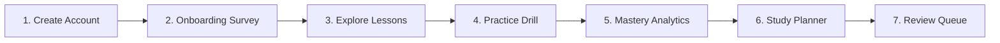

# Project Campus — Student Demonstration Walkthrough Guide

**Document Version:** 1.0.0  
**Status:** Approved for Product Demonstrations & Stakeholder Walkthroughs  
**Application URL:** [http://localhost:5173/](http://localhost:5173/)  
**Target Audience:** Students, Educators, Evaluators, and Product Reviewers  
**Date:** October 2026  

---

## 1. Overview & Launching the Website

Project Campus is designed to give secondary and entrance exam students a distraction-free, curriculum-aligned academic home. This guide provides a step-by-step sequence to demonstrate the entire student journey from registration to spaced repetition and DPDP account erasure.

### 1.1. Quick Launch Verification
Before beginning your demonstration, verify both servers are active:
* **Frontend:** Open [http://localhost:5173/](http://localhost:5173/) in your web browser.
* **Connectivity Indicator:** In the top-right header, confirm the badge displays `Backend Online` with a green indicator.

---

## 2. Recommended Demonstration Sequence

Follow this 7-step walkthrough to experience the complete platform:

### Step 1: Create a Synthetic Student Account
1. On the landing page hero banner, click the **"Create Student Account"** button (or click **"Sign In"** $\to$ **"Create one now"** in the top navigation).
2. Enter synthetic credentials:
   * **Full Name:** `Ananya Sharma` (or your name)
   * **Email:** `ananya.student@test.internal`
   * **Password:** `TestStudent#2026`
3. Click **"Create Student Account"**.
4. You will be authenticated immediately and redirected to the **Onboarding Wizard**.

---

### Step 2: Academic Onboarding Wizard (4 Steps)
1. **Step 1: Board & Grade Selection**
   * Select **"Central Board of Secondary Education (CBSE)"**.
   * Select **"Class 12 (+2)"**.
   * Click **"Continue"**.
2. **Step 2: Subject Enrollment**
   * Check **"Physics"** and **"Mathematics"** (or Chemistry / Biology).
   * Notice that the wizard dynamically updates selected subjects.
   * Click **"Continue"**.
3. **Step 3: Study Commitments**
   * **Target Exam Year:** Select `2027`.
   * **Daily Study Commitment:** Adjust slider to `120 minutes/day`.
   * **Preferred Language:** Leave as `English`.
   * Click **"Continue"**.
4. **Step 4: Confirmation**
   * Review your academic summary.
   * Click **"Complete Onboarding & Enter Dashboard"**.
   * The **Student Dashboard** mounts with your personalized curriculum header!

---

### Step 3: Discover Syllabus & Read a Structured Lesson
1. In the top navigation bar (or via the **"Browse Lessons"** button on the dashboard), click **"Lessons"**.
2. The **Curriculum Browser** displays the hierarchical syllabus:
   * Notice the active curriculum badge: `CBSE • Class 12`.
   * Under **Physics**, expand Chapter 1: **"Electric Charges and Fields"**.
   * Select Topic 1: **"Coulomb's Law, Electrostatic Force, and the Superposition Principle"**.
3. Click **"Read Lesson"**:
   * The **Lesson Viewer** loads with pedagogical structure:
     * High-level summary and estimated read time (`15 mins`).
     * Explicit learning objectives.
     * Content sections with crystal-clear **KaTeX LaTeX math rendering**:
       $$\vec{F}_{12} = \frac{1}{4\pi\varepsilon_0} \frac{q_1 q_2}{r^2} \hat{r}_{12}$$
     * Worked examples, key formulas, and pedagogical notes.
4. When finished reading, click **"Mark as Complete & Return"**:
   * Your reading progress transitions from `IN_PROGRESS` to `COMPLETED` and is persisted in the database!

---

### Step 4: Topic Practice Drill & Errata Reporting
1. From the lesson view (or back in the Curriculum Browser for the topic), click **"Start Topic Practice"**.
2. The **Practice Modal** opens with 3 curriculum-aligned questions:
   * **Question 1 (Single Choice):**
     * Read the prompt.
     * Select option **B** ($F/16$).
     * Click **"Submit Answer"**.
     * Instant feedback is displayed with educator explanation and derivation.
   * **Question 2 (Numerical):**
     * Enter the numerical answer in Newtons (e.g., `0.9`).
     * Submit and review the verified step-by-step solution.
   * **Question 3 (Multi-Select):**
     * Select multiple valid statements.
3. **Reporting Errata / Question Feedback:**
   * On any question card, click **"Report Issue"** in the bottom-right corner.
   * An **Errata Modal** opens.
   * Select issue type (`Typographical Error` or `Ambiguous Question`).
   * Add a brief note and click **"Submit Errata Ticket"**.
   * Feedback is captured and logged for educator review!
4. After answering all questions, the modal displays the **Practice Summary** with accuracy score and total time spent.

---

### Step 5: Real-Time Diagnostic Analytics & Mastery
1. Return to the **Student Dashboard** by clicking **"Dashboard"** in the top navigation bar.
2. In the **Summary KPIs** bar:
   * **Lessons Completed:** `1`
   * **Questions Answered:** `3`
   * **Overall Accuracy:** Displays your exact score.
   * **Practice Time:** Displays elapsed seconds.
3. Switch between the analytics tabs:
   * **Trends Tab:** View the SVG practice volume chart and accessible screen-reader table.
   * **Diagnostic Matrix Tab:** Filter topics by mastery state (`Developing`, `Needs Review`, `Strong`).
   * **Explainable Recommendations:** Read personalized suggestions explaining *why* a specific revision drill is advised.

---

### Step 6: Study Planner & Daily Tasks
1. Scroll to the **Daily Study Plan** card on your dashboard:
   * If today's plan is not yet generated, click **"Generate Plan"**.
   * The scheduler creates up to 4 prioritized tasks tailored to your enrolled subjects within your 120-minute daily budget.
2. **Task Completion:**
   * Click the circle icon on a task (e.g., "Read: Coulomb's Law").
   * The task is marked complete, striking through the title and updating your daily progress bar!
3. **Task Rescheduling:**
   * On an uncompleted task, click the **"Reschedule"** calendar icon.
   * Select a valid future date (past dates are rejected by safety guardrails).
   * Confirm the reschedule. The task moves forward seamlessly.
4. **Curriculum Roadmap:**
   * Check the **Curriculum Roadmap** card below the daily plan to inspect chapter-by-chapter completion percentages.

---

### Step 7: Spaced Repetition (SM-2) Review Queue
1. Look at the **Daily Review Queue** card:
   * Topics requiring spaced review appear with retention state badges (`LEARNING` or `REVIEW`).
2. Click **"Review Topic"** on an item:
   * The **Flashcard Review Modal** opens.
   * Review the prompt, then click **"Show Answer / Solution"** to flip the card.
   * Grade your recall quality from **0 (Total Blackout)** to **5 (Perfect Recall)**.
   * The SuperMemo-2 algorithm updates the ease factor, calculates the next optimal due date, and records the attempt in `review_logs`.

---

## 3. Account Reset & DPDP Right to Erasure

To demonstrate India's **Digital Personal Data Protection Act (DPDP Act 2023)** compliance:

1. Scroll to the bottom of the **Student Dashboard**.
2. Locate the **"Privacy & Data Protection (DPDP Act 2023)"** section.
3. Click the red button: **"Delete Account & Wipe Academic History"**.
4. An alert modal appears requiring explicit confirmation.
5. Click **"Permanently Delete My Account"**.
6. **Result:**
   * Your user identity, profile, enrolled subjects, and progress records are permanently deleted.
   * Your session token is destroyed.
   * You are safely returned to the public landing page as a guest!

---

## 4. Known Limitations & Future Enhancements

| Area | Current Implementation | Planned Post-Pilot Enhancement |
| :--- | :--- | :--- |
| **Authentication Tokens** | 60-minute sliding JWT access token delivered via JSON + HttpOnly cookie | Database-persisted SHA-256 refresh tokens with single-use rotation |
| **Rate Limiting** | In-memory sliding window `AuthRateLimiter` (10 req/min) | Distributed Redis 7 token bucket cluster for multi-worker scaling |
| **Backups** | Local compressed custom-format archives with safety-checked restore | Automated AES-256 encrypted off-site replication to cloud object storage |
| **Browser Testing** | 10-stage API integration test suite + Vitest component tests | Full-lifecycle Playwright browser automation in headless Chromium/WebKit |
| **AI Concept Clarifier** | Architecture & safety guardrails specified | LLM provider integration with grounded syllabus context injection |
