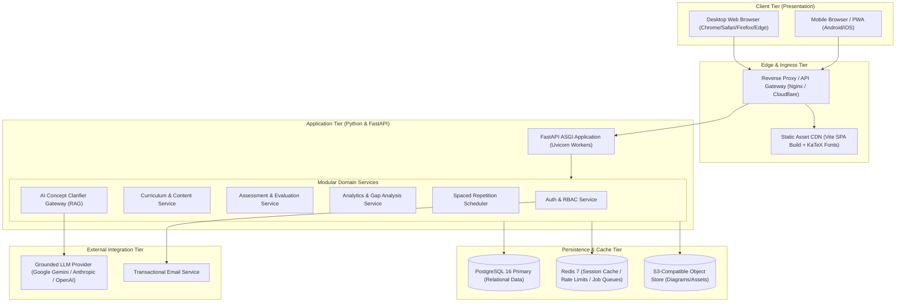
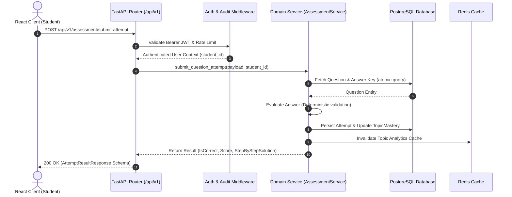

# Project Campus — Technical Architecture Specification

**Document Version:** 1.0.0  
**Status:** Approved for Architecture Planning  
**Target Systems:** Web (Desktop & Mobile Responsive)  
**Last Updated:** October 2026  

---

## 1. Architectural Vision & Topology

Project Campus is designed as a modular, service-oriented multi-tier web application built for high reliability, clean separation of concerns, and verifiable educational accuracy. The system prioritizes deterministic business logic, sub-second API latencies, and crystal-clear separation between authoritative textbook data and dynamic AI interactions.



---

## 2. Technology Stack Justification

| Layer | Selected Technology | Version | Architectural Justification |
| :--- | :--- | :--- | :--- |
| **Frontend Framework** | **React** with **TypeScript** | React 18+, TS 5.x | Industry standard for complex, stateful client applications. Strict typing eliminates runtime errors in complex assessment scoring and math rendering. |
| **Build & Bundler** | **Vite** | 5.x+ | Ultra-fast HMR, optimized tree-shaking, fast ESM builds, and lean bundle outputs for mobile networks. |
| **Styling & Components**| **Tailwind CSS** + Headless UI / Radix | Modern | Utility-first CSS provides deterministic styling, minimal CSS bundle overhead, dark/light theme support, and full mobile responsiveness down to 360px. |
| **Math & Formula Engine**| **KaTeX** | 0.16+ | Considerably faster than MathJax (up to 100x faster DOM rendering). Supports the full standard LaTeX math syntax required for JEE/NEET Physics, Chem, and Math. |
| **State Management** | **TanStack Query** (React Query) + **Zustand** | Latest | Server state caching, optimistic updates, and background refetching via TanStack Query; lightweight local client state via Zustand. |
| **Backend Framework** | **Python** with **FastAPI** | Python 3.12+ / 3.14+, FastAPI 0.115+ | High-throughput asynchronous ASGI web framework. Native Pydantic v2 validation guarantees type safety and automated OpenAPI documentation. First-class AI/ML library support in Python. |
| **ORM & Migrations** | **SQLAlchemy 2.0** (Asyncio) + **Alembic** | SQLAlchemy 2.x, Alembic 1.13+ | Fully typed async ORM with high-performance connection pooling. Alembic provides deterministic, auditable, and rollback-capable database schema migrations. |
| **Primary Database** | **PostgreSQL** | 16+ | Enterprise-grade ACID compliance, robust support for JSONB (for polymorphic question options and exam answers), full-text search, and analytical window functions. |
| **Local Dev DB Support** | **SQLite (via aiosqlite)** | 3.x | Zero-dependency local fallback for instant local developer onboarding where PostgreSQL is not yet configured. |
| **Cache & Task Queue** | **Redis** | 7.x | Sub-millisecond session validation, rate limiting, leaderboards, and temporary practice session caching. |

---

## 3. Frontend Architecture

### 3.1. Directory Structure

```
frontend/
├── public/                 # Static assets, favicon, manifest.json
├── src/
│   ├── assets/             # Brand logos, placeholder graphics
│   ├── components/         # Shared presentation components
│   │   ├── common/         # Button, Input, Modal, Dropdown, Spinner
│   │   ├── layout/         # Header, Sidebar, Footer, NavigationBar
│   │   ├── math/           # KaTeX MathRenderer (inline and block)
│   │   └── feedback/       # Alert, Toast, ErrorBoundary, Skeleton
│   ├── features/           # Feature-sliced modular domains
│   │   ├── auth/           # Login, Register, ForgotPassword, Profile
│   │   ├── curriculum/     # SyllabusTree, SubjectCard, TopicList
│   │   ├── lessons/        # LessonViewer, ReadingProgress, Notes
│   │   ├── assessment/     # QuestionCard, OptionSelector, SolutionModal
│   │   ├── ai-tutor/       # AITutorChat, GroundedReferenceBadge
│   │   ├── analytics/      # MasteryHeatmap, PerformanceChart, WeakTopicList
│   │   └── planner/        # DailyRevisionQueue, ExamCountdownWidget
│   ├── hooks/              # Custom React hooks (useAuth, usePractice, useTheme)
│   ├── services/           # Axios / Fetch client API integration
│   ├── stores/             # Zustand state stores
│   ├── types/              # TypeScript interface and type declarations
│   ├── utils/              # Formatting, date helpers, LaTeX sanitization
│   ├── App.tsx             # Root component with routing and providers
│   └── main.tsx            # Application entry point
├── index.html
├── package.json
├── tsconfig.json
└── vite.config.ts
```

### 3.2. Formula and Content Rendering Architecture
Complex scientific and mathematical content is authored in Markdown with embedded LaTeX:
* Single `$` delimiters denote inline formulas: `$E = mc^2$`.
* Double `$$` delimiters denote block equations:
  $$\int_{a}^{b} f(x) dx = F(b) - F(a)$$
* KaTeX is configured with error-fallback rendering (graceful degradation so malformed LaTeX displays raw text rather than breaking the application view).
* Chemical notation is rendered using `mhchem` extensions via KaTeX.

---

## 4. Backend Architecture

### 4.1. Modular Monolith Design
To ensure fast development velocity without the operational overhead of microservices, Project Campus employs a **Modular Monolith** architecture. Each domain module encapsulates its own routes, business services, repository models, and Pydantic schemas.

```
backend/
├── app/
│   ├── api/                # API Route Controllers
│   │   ├── v1/
│   │   │   ├── endpoints/
│   │   │   │   ├── auth.py
│   │   │   │   ├── users.py
│   │   │   │   ├── curricula.py
│   │   │   │   ├── lessons.py
│   │   │   │   ├── assessment.py
│   │   │   │   ├── analytics.py
│   │   │   │   ├── planner.py
│   │   │   │   ├── ai_tutor.py
│   │   │   │   └── cms.py
│   │   │   └── api.py      # Aggregated v1 API Router
│   ├── core/               # Cross-cutting foundational modules
│   │   ├── config.py       # Pydantic BaseSettings (.env loading)
│   │   ├── database.py     # SQLAlchemy async engine & sessionmaker
│   │   ├── security.py     # Password hashing, JWT signing, token validation
│   │   ├── middleware.py   # CORS, RequestID, Rate limiting, Audit logs
│   │   └── exceptions.py   # Standardized HTTP and domain exceptions
│   ├── models/             # SQLAlchemy ORM Database Models
│   │   ├── base.py
│   │   ├── user.py
│   │   ├── curriculum.py
│   │   ├── lesson.py
│   │   ├── question.py
│   │   ├── attempt.py
│   │   └── study_plan.py
│   ├── schemas/            # Pydantic v2 Request/Response Data Contracts
│   │   ├── auth.py
│   │   ├── user.py
│   │   ├── curriculum.py
│   │   ├── lesson.py
│   │   ├── question.py
│   │   ├── analytics.py
│   │   └── ai_tutor.py
│   ├── services/           # Pure Domain Business Logic
│   │   ├── auth_service.py
│   │   ├── curriculum_service.py
│   │   ├── assessment_service.py
│   │   ├── analytics_service.py
│   │   ├── spaced_repetition_service.py
│   │   ├── ai_gateway_service.py
│   │   └── cms_service.py
│   └── main.py             # FastAPI App instance and lifecycle handlers
├── alembic/                # Database Migrations
│   ├── versions/
│   └── env.py
├── tests/                  # Automated Test Suites
│   ├── unit/
│   ├── integration/
│   └── conftest.py
├── requirements.txt
└── alembic.ini
```

### 4.2. Request Lifecycle & Layered Boundaries



---

## 5. AI Concept Clarifier (Transparent AI Gateway)

### 5.1. Design Principles
1. **Never Serve Unverified Answer Keys:** The AI service is strictly prohibited from generating primary answers for unattempted questions to preserve academic rigor and prevent cheating.
2. **Retrieval-Augmented Grounding (RAG):** When a student asks "Why does Lenz's law satisfy the conservation of energy?", the query is bounded with the verified chapter textbook excerpts.
3. **Transparent Provenance:** All AI outputs are returned with source chapter metadata and the explicit label:
   `[AI Concept Explanation — Reviewed against Class 12 Physics: Electromagnetic Induction]`
4. **Safety Guardrails:** Real-time toxicity filtering, prompt-injection defense, and syllabus-boundary enforcement.

```mermaid
flowchart LR
    StudentPrompt["Student Query + Current Topic Context"] --> Guardrail["Input Guardrail & Prompt Sanitizer"]
    Guardrail --> ContextRetriever["RAG Context Builder (Chapter Excerpts)"]
    ContextRetriever --> SystemPromptEngine["Pedagogical System Prompt"]
    SystemPromptEngine --> LLM["LLM Inference (Gemini / Anthropic / Local)"]
    LLM --> OutputFilter["Output Safety & Math Syntax Validator"]
    OutputFilter --> ResponseEnvelope["Envelope with AI-Badge & Topic Citations"]
```



---

## 6. Deployment & Infrastructure Strategy

* **Containerization:** Clean Dockerfiles for `frontend` (multi-stage build with Nginx) and `backend` (Python slim with Uvicorn).
* **Local Development:** `docker-compose.yml` orchestrating PostgreSQL, Redis, FastAPI, and Vite dev servers.
* **Production Cloud Target:** Containerized orchestration (AWS ECS / Google Cloud Run / Kubernetes / Render) behind Cloudflare or AWS CloudFront for SSL termination, DDoS protection, and edge asset caching.
* **Storage:** S3-compatible cloud object storage (Cloudflare R2 or AWS S3) for uploaded diagrams and educational PDF attachments.
