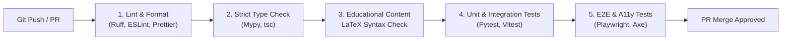

# Project Campus — Comprehensive Testing Strategy

**Document Version:** 1.0.0  
**Status:** Approved for Quality Assurance  
**Testing Frameworks:** Pytest, Vitest, Playwright, axe-core, k6  
**Last Updated:** October 2026  

---

## 1. Testing Philosophy & Guiding Principles

At Project Campus, software quality and educational correctness are inseparable:
1. **Never Invent Test Results:** A feature is never claimed to work based on conjecture or simulated assumptions. Every assertion must be proven by a passing, reproducible test suite.
2. **Deterministic Evaluation:** Student assessment scoring and spaced repetition algorithms must behave with 100% deterministic mathematical precision.
3. **Automated Quality Gates:** Pull requests cannot be merged without clean linting, zero type errors, passing automated tests, and validated LaTeX syntax.
4. **Zero Flakiness:** Tests must be isolated, independent of external network availability, and clean up their test state automatically.

---

## 2. Testing Pyramid & Test Levels

```
                     / \
                    /   \
                   / E2E \       <-- Playwright (Critical Student Journeys)
                  /-------\
                 /  Integ  \     <-- Pytest + AsyncClient (API & DB Operations)
                /-----------\
               /    Unit     \   <-- Pytest (Domain Services) & Vitest (React Components)
              /---------------\
             / Static Analysis \ <-- Ruff, Mypy, ESLint, TypeScript Compiler, KaTeX Validator
            /-------------------\
```

### 2.1. Static Analysis & Type Checking
* **Backend:**
  * **Ruff:** Ultra-fast linting and code formatting conforming to PEP 8.
  * **Mypy:** Strict static type analysis with `--strict` mode enforced across all domain models, schemas, and services.
* **Frontend:**
  * **TypeScript (`tsc --noEmit`):** Strict null checks and complete interface enforcement.
  * **ESLint & Prettier:** Automated code style and React hook dependency enforcement.
* **Content / LaTeX Syntax Linter:**
  * Automated validator parses every question and lesson LaTeX string to guarantee zero unescaped brackets or unsupported KaTeX macros before saving.

### 2.2. Unit Testing
* **Backend Unit Tests (Pytest):**
  * **Assessment Evaluation Engine:** Validates Single-Choice matching, Multi-Choice partial and full scoring, Numerical tolerance bounds (e.g., $9.81 \pm 0.05$), and Integer verification.
  * **Spaced Repetition Engine (SM-2):** Tests interval progressions ($I(1) = 1, I(2) = 6$), ease factor adjustments ($EF' = EF + (0.1 - (5 - q) \cdot (0.08 + (5 - q) \cdot 0.02))$), and boundary clamps ($EF \ge 1.3$).
  * **Analytics Aggregator:** Tests topic mastery score calculations, accuracy percentage edge cases (0 attempts, 100% accuracy), and learning gap tier classification.
* **Frontend Unit Tests (Vitest + React Testing Library):**
  * Presentation components: `Button`, `Modal`, `Alert`, `MathRenderer`.
  * Practice components: `QuestionCard` renders options, handles selection, triggers callbacks.
  * Accessibility: Screen-reader labels present on interactive controls.

### 2.3. Integration Testing (API & Database)
* **Framework:** `pytest-asyncio` with `httpx.AsyncClient` executing against an isolated test database.
* **Database Strategy:**
  * Migrations are executed via Alembic on the test database prior to test execution.
  * Each test function executes within a transactional rollback block or uses a dedicated ephemeral database container to ensure 100% test isolation.
* **Key Integration Test Suites:**
  * **Auth & Security:** User registration, duplicate email rejection, password verification, expired JWT rejection, role-based authorization denials (e.g., Student trying to publish a question).
  * **Curriculum Traversal:** Fetching syllabus trees, handling non-existent subject IDs with 404 responses.
  * **Assessment Lifecycle:** Starting a practice session, submitting individual attempts, verifying atomic score increments and mastery updates.
  * **Errata Reporting:** Student submitting an errata ticket, reviewer fetching queue, reviewer updating question status.

### 2.4. End-to-End (E2E) Journey Testing
The system validates complete, continuous student lifecycles to ensure seamless integration across subsystems:

* **Current Active Implementation (`tests/test_student_journey_e2e.py`):**
  Full-lifecycle HTTP API integration tests using `pytest-asyncio` and `httpx.AsyncClient` that validate a continuous timeline:
  1. Student registration & identity verification (`/auth/register`, `/auth/me`).
  2. Academic onboarding & curriculum selection (`/curricula/`, `/student/onboarding`).
  3. Syllabus discovery & published lesson access (`/curricula/subjects/{id}/chapters`, `/curricula/lessons/{id}`).
  4. Reading progress tracking (`/student/progress/lessons/{id}/start`, `/complete`).
  5. Practice drill session, answer evaluation & errata ticketing (`/practice/sessions`, `/practice/submit`, `/report-errata`).
  6. Diagnostic analytics, topic mastery & explainable recommendations (`/student/analytics/dashboard`, `/topics`, `/recommendations`).
  7. Study goal customization (`/planner/goal`).
  8. Daily study plan generation, task completion & valid rescheduling (`/planner/daily/generate`, `/planner/tasks/{id}/complete`, `/reschedule`).
  9. Curriculum roadmap navigation (`/planner/roadmap`).
  10. DPDP Act 2023 account deletion & cascading personal record erasure (`/student/account`).
  - **Boundary & Security Coverage:** Cross-student IDOR isolation, expired/malformed token rejection, empty state recommendation handling, and past-date rescheduling denial.

* **Planned Post-Pilot Browser Automation (Playwright):**
  Headless browser E2E tests simulating full UI clicks, DOM rendering, and keyboard traversal in Chromium/WebKit are scheduled for implementation prior to public production launch.

### 2.5. Accessibility & Mobile Responsive Testing
* **Current Active Implementation:**
  - Vitest + React Testing Library component tests across 11 suites (48 tests).
  - Keyboard navigation: Escape key dismissal, backdrop click closing, and ARIA dialog attributes across all modals (`AuthModal`, `StudyGoalModal`, `ErrataModal`, `PracticeModal`, `FlashcardReviewModal`).
  - Screen-reader accessible tables accompanying SVG charts in `PracticeTrendChart`.
* **Planned Post-Pilot Enhancements:**
  - Automated `@axe-core/playwright` scanning in CI pipeline.
  - Viewport visual regression matrix (360px, 390px, 768px, 1440px).
  * Mobile Portrait: 360 x 800 (Samsung Galaxy / Android standard)
  * Mobile Modern: 390 x 844 (iPhone 14/15)
  * Tablet: 768 x 1024 (iPad)
  * Desktop: 1440 x 900 and 1920 x 1080

### 2.6. Performance & Load Benchmarking
* **Tool:** `k6` or `Locust`.
* **Targets:**
  * 100 concurrent students taking practice quizzes: API p95 response time $< 250$ms.
  * Cache hit ratio on published syllabus endpoints $\ge 95\%$.

---

## 3. Test Automation & CI/CD Pipeline Gates

Every pull request must pass the following automated gate stages in sequence:



---

## 4. Content Integrity Automated Check Suite

To enforce the Content Quality Policy, the repository includes an automated pedagogical validation test suite (`tests/content/test_content_integrity.py`):

1. **LaTeX Compilability Check:** Every question and lesson string is tested against KaTeX grammar to catch unclosed brackets, invalid math commands, or malformed matrices.
2. **Single-Choice Integrity:** Verifies that every `SINGLE_CHOICE` question has exactly one option matching the answer key.
3. **Multiple-Choice Integrity:** Verifies that every `MULTIPLE_CHOICE` question has $\ge 1$ correct options and $\le$ total options.
4. **Numerical Bounds Check:** Verifies that every `NUMERICAL` question specifies a non-null numerical value and a positive tolerance ($\delta > 0$).
5. **Solution Completeness:** Asserts that every published question has a non-empty `step_by_step_explanation_latex` of at least 50 characters.
